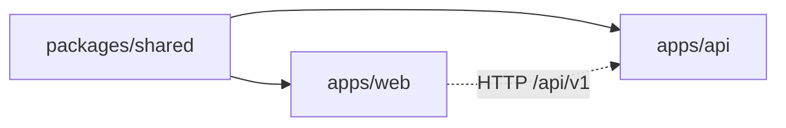

# ساختار پوشه‌ها

> فصل ۱ — شروع

## نمای کلی
```text
site-builder/
├── packages/shared/      ← schemaهای zod و منطق مشترک بین API و وب
├── apps/api/             ← سرور Express 5 + Postgres
├── apps/web/             ← React + Vite: پنل ادمین، builder و سایت عمومی
├── deploy/               ← Docker، nginx، سرویس deploy، بستهٔ مشتری، backup
├── tools/guide-videos/   ← ضبط ویدیوهای راهنمای کاربر (Playwright)
├── docs/                 ← مستندات (این پوشه)
├── Dockerfile            ← همهٔ imageها از این یک فایل ساخته می‌شوند
├── AGENTS.md             ← راهنمای کوتاه انگلیسی برای agentها
└── docker-compose.yml    ← قدیمی (نسخهٔ اول)؛ استفاده نکنید
```

## وابستگی پکیج‌ها

`shared` هیچ چیزی از دو پکیج دیگر import نمی‌کند. API و وب هم هیچ‌وقت از هم import نمی‌کنند و فقط
از طریق HTTP با هم حرف می‌زنند.

## `packages/shared/src`
| فایل | چه دارد |
|---|---|
| `constants.ts` | نقش‌ها، `PERMISSIONS`، ماژول‌ها، وضعیت سایت‌ها |
| `schemas.ts` | تنظیمات سایت (`siteSettingsSchema`)، صفحه، محصول، سفارش، درخواست، درگاه |
| `sections.ts` | کتابخانهٔ سکشن‌ها (`sectionDefinitions`)، `SYSTEM_PAGES`، `contentOnlyChange` |
| `siteOptions.ts` | header، footer، طراحی (فونت و رنگ)، فیلدهای فرم |
| `collections.ts` | جدول‌های محتوا، فیلترها، باکس‌ها، presetها |
| `interactions.ts` / `forms.ts` | فرم درخواست، workflow، حساب مشتری؛ تبدیل فرم‌های نسخهٔ ۱ |
| `setup.ts` | ورودی ساخت سایت جدید (`siteSetupSchema`) |
| `bank.ts` | site kits (بانک محتوا) |
| `starters.ts` | ساختار starter pack |

## `apps/api/src`
| مسیر | چه دارد |
|---|---|
| `server.ts` / `app.ts` | شروع سرور؛ وصل کردن همهٔ routeها و middlewareها |
| `cli.ts` | دستورات `migrate`، `set-password`، `provision`، `add-sample-starters` |
| `cell-bootstrap.ts` | راه‌اندازی اولیه روی سرور مشتری |
| `context.ts` | `AppContext`: اتصال دیتابیس کنترل، poolهای سایت‌ها، storage، ایمیل و SMS |
| `config/env.ts` | همهٔ متغیرهای محیطی با zod |
| `common/` | `http.ts` (`ApiRouter`)، `errors.ts`، `crypto.ts`، `sql.ts`، `logger.ts` |
| `middleware/` | `auth.ts` (session، CSRF)، `tenant.ts` (پیدا کردن سایت، دسترسی، ماژول)، `errors.ts` |
| `database/` | `migrator.ts`، migrationهای `control-plane/` و `tenant/`، `tenant/pools.ts` |
| `storage/` | ذخیرهٔ فایل (local یا S3) و route فایل‌ها |
| `modules/<name>/` | هر قابلیت: `*.routes.ts` (آدرس‌ها) و `*.service.ts` (منطق) |
| `../test/` | تست‌های vitest روی Postgres واقعی |

ماژول‌ها: `assets`، `audit`، `auth`، `bank`، `catalog`، `collections`، `customers`، `interactions`،
`leads`، `members`، `orders`، `pages`، `payments`، `platform`، `public`، `shop`، `site`، `starters`.

## `apps/web/src`
| مسیر | چه دارد |
|---|---|
| `main.tsx`، `app/` | شروع برنامه و جدول مسیرها (`app/routes.tsx`) |
| `admin/` | پنل ادمین (lazy load) |
| `admin/builder/` | ویرایشگر صفحه: `BuilderPage`، `Inspector`، `fields.ts`، `state.ts`، `PreviewFrame` |
| `admin/pages/` | صفحه‌های پنل: سایت‌ها، تنظیمات، صندوق درخواست‌ها، فروشگاه، starterها… |
| `admin/collections/`، `admin/interactions/` | جدول‌های محتوا؛ طراح فرم و workflow |
| `features/` | بخش‌های سایت عمومی: `public-site`، `cart`، `account`، `collections`، `leads`، `wishlist` |
| `sections/` | رندر سکشن‌ها: `renderers.tsx` (جدول renderer هر نوع)، `SectionRenderer.tsx` |
| `components/` | layout سایت و اجزای UI |
| `lib/` | `api.ts` (کلاینت API)، `errorText.ts`، `calendar.ts`، `preferences.tsx`… |
| `content/` | محتوای نمایشی وقتی API در دسترس نیست |
| `scripts/prerender.mjs` | ساخت HTML ایستا برای SEO هنگام build |
| `test/` | تست‌های وب |

## `deploy/`
| مسیر | چه دارد |
|---|---|
| `docker-compose.yml` | استودیو (پروژهٔ compose به نام `site-builder`) |
| `edge/nginx.conf` | مسیریابی همهٔ آدرس‌ها |
| `studio/api-start.sh` | کارهایی که API استودیو در هر بار شروع انجام می‌دهد |
| `control/server.mjs` | سرویس deploy (بدون وابستگی npm) |
| `export/` | فایل‌هایی که داخل هر بستهٔ مشتری قرار می‌گیرند |
| `cell/api-start.sh` | شروع API روی سرور مشتری |
| `backup/` | backup و restore کل استودیو |
| `photos/` | دانلود عکس‌های قالب‌ها به `var/demo-images` |

## پوشه‌هایی که در Git نیستند
`var/` (عکس‌ها و فایل‌های محلی)، `exports/` (بسته‌های مشتری)، `backups/`، `.env` و `deploy/.env`.
این‌ها دادهٔ مشتری و رمز دارند و **هرگز** نباید commit شوند.

## اگر بخواهید…
- معنی اصطلاح‌ها را بدانید → [واژه‌نامه](glossary.md)
- ببینید این قطعه‌ها در اجرا چطور به هم وصل می‌شوند → [نمای کلی معماری](../02-architecture/overview.md)
