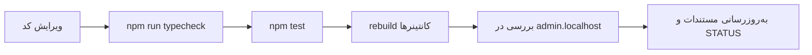

# راه‌اندازی محیط توسعه

> فصل ۱ — شروع · فایل‌ها: `deploy/docker-compose.yml`، `deploy/.env.example`، `package.json`

## خلاصه
برای توسعه سه چیز لازم دارید:
- **استودیو** که در Docker اجرا می‌شود و تغییراتتان را در مرورگر نشانش می‌دهد،
- **Node.js** برای typecheck و اجرای تست‌ها روی سیستم خودتان،
- یک **Postgres جدا برای تست‌ها** روی پورت 5433.

## پیش‌نیازها
| ابزار | نسخه | برای |
|---|---|---|
| Docker Desktop | روشن و در حال اجرا | استودیو و دیتابیس تست |
| Node.js | ۲۲ (Dockerfile از `node:22-alpine` استفاده می‌کند) | `npm install`، typecheck، تست |
| Git | — | کد |
| VS Code (اختیاری) | با افزونهٔ Mermaid | خواندن همین مستندات |

## ۱. دریافت کد و نصب پکیج‌ها
```bash
git clone https://github.com/bonshad2026/site-builder.git
cd site-builder
git switch develop
npm install
```
پروژه یک **npm workspace** است. با یک بار `npm install` در ریشه، هر سه پکیج نصب می‌شوند:
`packages/shared`، `apps/api` و `apps/web`.

> اگر `npm install` به mirror داخل lockfile وصل نشد، در `deploy/.env` مقدار
> `NPM_REGISTRY=https://registry.npmjs.org/` را بگذارید (برای ساخت Docker). روی سیستم خودتان هم می‌توانید
> `npm install --registry=https://registry.npmjs.org/` بزنید.

## ۲. ساخت فایل تنظیمات
```bash
cp deploy/.env.example deploy/.env
```
مقدارها را پر کنید. هر کلید ۳۲ بایت تصادفی است:
```bash
node -e "console.log(require('crypto').randomBytes(32).toString('base64'))"
```
| کلید | چیست |
|---|---|
| `CONTROL_ADMIN_EMAIL` / `CONTROL_ADMIN_PASSWORD` | ورود اپراتور به استودیو (محلی: `admin` / `123456`). در هر بار شروع API دوباره روی همین مقدار تنظیم می‌شود |
| `STUDIO_DB_PASSWORD` | رمز کاربر `sb_admin` دیتابیس استودیو |
| `STUDIO_API_DB_PASSWORD` | رمز کاربر `sb_api` که API با آن به `sb_control` وصل می‌شود |
| `STUDIO_TENANT_SECRETS_KEY` | کلید رمزکردن رمزهای دیتابیس سایت‌ها (باید base64 و ۳۲ بایت باشد) |
| `STUDIO_STORAGE_SIGNING_KEY` | امضای لینک فایل‌های خصوصی |
| `SITE_OPERATOR_*` / `SITE_OWNER_*` | حساب‌های پیش‌فرض بسته‌هایی که برای مشتری ساخته می‌شود |
| `EXPORT_DIR` | پوشه‌ای که بسته‌های مشتری در آن ساخته می‌شوند |

اگر از یک backup شروع می‌کنید، `deploy/.env` داخل همان backup است؛ راهنمای
[`HANDOFF.fa.md`](../../HANDOFF.fa.md) را ببینید.

## ۳. اجرای استودیو
```bash
docker compose -f deploy/docker-compose.yml up -d --build
```
ساخت اول چند دقیقه طول می‌کشد. بعد:
- پنل: http://admin.localhost (ورود با حساب اپراتور)
- پیش‌نمایش هر سایت: `http://<slug>.preview.localhost`
- سرویس deploy: http://admin.localhost/deploy/

مرورگرها آدرس‌های `*.localhost` را خودشان به 127.0.0.1 می‌برند و تنظیم `hosts` لازم نیست.
(Node.js این کار را نمی‌کند؛ برای همین اسکریپت‌ها مستقیم به `127.0.0.1:4000` وصل می‌شوند.)

## ۴. دیتابیس تست
تست‌های API روی Postgres واقعی اجرا می‌شوند، روی پورت **5433** (جدا از استودیو):
```bash
docker run -d --name sb-test-pg -p 127.0.0.1:5433:5432 -e POSTGRES_USER=sb_admin -e POSTGRES_PASSWORD=sb_admin_dev_password postgres:16-alpine
```
دفعه‌های بعد فقط:
```bash
docker start sb-test-pg
```

## ۵. بررسی اینکه همه‌چیز سالم است
```bash
npm run typecheck
```
```bash
npm test
```
در تاریخ 2026-11-02 هر دو بدون خطا هستند: وب ۴۳ تست و API ۱۰۴ تست.

## ۶. چرخهٔ هر تغییر

rebuild فقط برای دو کانتینر برنامه:
```bash
docker compose -f deploy/docker-compose.yml up -d --build studio-api studio-web
```

## اجرای بدون Docker (اختیاری)
برای کار سریع روی رابط کاربری می‌توانید وب را با Vite و hot reload اجرا کنید (`npm run dev` در ریشه).
اما API و دیتابیس همچنان باید در دسترس باشند و آدرس‌های preview (`*.preview.localhost`) فقط از طریق nginx
استودیو کار می‌کنند. برای همین روش اصلی این پروژه rebuild کانتینرهاست.

## اگر بخواهید…
- بدانید هر پوشه چه دارد → [ساختار پوشه‌ها](folders.md)
- دستورات روزانهٔ Docker را ببینید → [Docker و اجرای روزانه](../06-operations/docker.md)
- با مشکل نصب روبه‌رو شدید → [عیب‌یابی](../06-operations/troubleshooting.md)

## نتیجهٔ بررسی در ۲۰۲۶-۱۱-۰۶

بررسی تایپ بدون خطا است. API: ۱۰۵ تست موفق از ۱۰۵؛ وب: ۴۸ موفق و ۴ شکست از قبل موجود (۵۲ تست). هر ۹ تست جدید ارسال سفارش موفق‌اند. شکست‌های قبلی شامل فیلتر محصول، ثبت سفارش آزمایشی و دو تست دسترسی پنل هستند.

وضعیت فعلی: سرویس‌ها به درخواست مالک متوقف‌اند؛ راه‌اندازی بعدی با درخواست او انجام شود.
راهنمای ادامهٔ کافه در `docs/clients/cafe-mohammad/operations.md` است. وب اکنون ۵۷ تست دارد:
آخرین اجرای کامل برای ۵۴ تست (۵۰ موفق، ۴ خطای قبلی) بود و سه تست جدید به شکل متمرکز پاس شدند.
آخرین اجرای کامل API، ۱۲۳ موفق بود.
