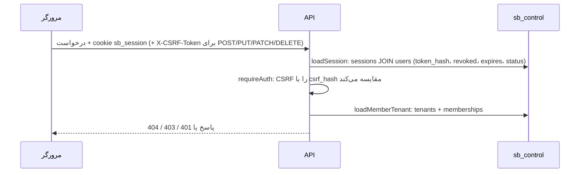

# احراز هویت و نقش‌ها

> فصل ۲ — معماری · فایل‌ها: `apps/api/src/middleware/auth.ts`، `apps/api/src/middleware/tenant.ts`،
> `apps/api/src/modules/auth/`، `apps/api/src/modules/customers/`، `packages/shared/src/constants.ts`

## خلاصه
دو نوع ورود کاملاً جدا وجود دارد:

| | کاربران پنل | مشتریان سایت |
|---|---|---|
| چه کسانی | اپراتور، مالک، کارمند | بازدیدکننده‌ای که در سایت حساب ساخته |
| کجا ذخیره می‌شوند | دیتابیس کنترل (`users`، `sessions`) | دیتابیس همان سایت (`customers`، `customer_sessions`) |
| cookie | `sb_session` و `sb_csrf` | `sb_c_<slug>` و `sb_cc_<slug>` |
| هدر CSRF | `X-CSRF-Token` | `X-Customer-CSRF` |
| آدرس‌ها | `/api/v1/auth/…` | `/api/v1/public/sites/:slug/customer/…` |

## کاربران پنل
### ورود
`POST /api/v1/auth/login` با نام کاربری یا ایمیل و رمز. ورود با کد SMS هم هست: `/otp/request` و
بعد `/otp/login`. رمزها با **argon2id** هش می‌شوند (`auth.service.ts`). مسیرهای ورود rate limit دارند.

پس از ورود:
- cookie `sb_session` (HttpOnly) ساخته می‌شود. فقط **هش** token در جدول `sessions` ذخیره می‌شود.
- cookie `sb_csrf` (قابل خواندن با JavaScript) هم ساخته می‌شود.
- عمر session برابر `SESSION_TTL_HOURS` است (پیش‌فرض ۷ روز).

### هر درخواست

**CSRF به روش double-submit:** وب مقدار cookie `sb_csrf` را در هدر `X-CSRF-Token` می‌فرستد
(`apps/web/src/lib/api.ts`). API هش هدر را با `csrf_hash` همان session مقایسه می‌کند. این بررسی فقط
روی routeهایی است که ورود لازم دارند، پس فرم‌های عمومی بی‌نام تحت تأثیر نیستند.

### نقش‌ها
| نقش | از کجا | دسترسی |
|---|---|---|
| اپراتور (`platform_admin`) | `users.is_platform_admin` | همهٔ سایت‌ها، همهٔ مجوزها، routeهای `/platform` |
| مالک (`owner`) | `memberships.role` | همهٔ مجوزهای سایت خودش |
| کارمند (`staff`) | `memberships.role` + `memberships.permissions` | فقط مجوزهایی که مالک داده |

مجوزها (`PERMISSIONS` در shared): `site:write`، `pages:write`، `catalog:write`، `assets:write`،
`leads:read`، `leads:write`، `orders:read`، `orders:write`، `payments:manage`.

### نگهبان‌های route
| middleware | کجا | چه می‌کند |
|---|---|---|
| `requireAuth` | `middleware/auth.ts` | ورود + CSRF |
| `requirePlatformAdmin` | `middleware/auth.ts` | ورود + CSRF + اپراتور |
| `requirePermission('x')` | `middleware/tenant.ts` | مجوز در همین سایت؛ وگرنه 403 |
| `requireOwner` | `middleware/tenant.ts` | فقط مالک یا اپراتور |
| `requireModule('x')` | `middleware/tenant.ts` | ماژول سایت روشن باشد؛ وگرنه `403 module_disabled` |
| `operatorOnly` | `app.ts`، `pages.routes.ts` | در cell فقط اپراتور (ساختار سایت) |

> پنهان کردن یک دکمه در رابط کاربری **کافی نیست**. هر محدودیت باید در API هم با یکی از این
> middlewareها اعمال شود.

## قفل مشتری در cell (`clientLocked`)
وقتی `CELL_SLUG` تنظیم شده است (سرور مشتری)، کاربرِ غیراپراتور:
- **صفحه‌ها:** فقط متن و تصویر سکشن‌های موجود را عوض می‌کند. `contentOnlyChange` (shared
  `sections.ts`) سند قبلی و جدید را مقایسه می‌کند و افزودن، حذف، جابه‌جایی یا پنهان کردن سکشن و تغییر
  کلیدهای ساختاری را رد می‌کند.
- **تنظیمات:** در `PUT /settings` فقط فیلدهای محتوایی از مشتری گرفته می‌شود: نام، شعار، لوگو، تماس،
  شبکه‌های اجتماعی، دسته‌بندی‌ها، نام نوع درخواست‌ها و مراحل، متن پیام‌ها، footer، قوانین فروشگاه و…
  (`site.routes.ts`). فرم‌ها، workflowها، حساب‌ها و `settings.texts` مال اپراتور است.
- **وب:** با `VITE_ADMIN_SCOPE=client` ساخته می‌شود؛ `OPERATOR_UI` در `admin/auth.tsx` غلط است و
  کد builder اصلاً داخل bundle نیست.

اپراتور با **SSO** وارد پنل مشتری می‌شود: سرویس deploy یک لینک امضاشده با `CELL_SSO_SECRET` می‌سازد،
و `GET /api/v1/auth/sso` (`modules/auth/sso.ts`) اگر لینک معتبر، تاریخ‌نگذشته و استفاده‌نشده باشد
session باز می‌کند.

## مشتریان سایت
اختیاری است (`settings.accounts`). ورود با تلفن یا ایمیل + کد یک‌بارمصرف، و در صورت تمایل رمز:

| آدرس (`/api/v1/public/sites/:slug/…`) | کار |
|---|---|
| `POST customer/code` | ارسال کد (ثبت‌نام، ورود، بازیابی رمز) |
| `POST customer/signup` | ساخت حساب با کد |
| `POST customer/login` | ورود با رمز یا کد |
| `POST customer/reset` | رمز جدید با کد |
| `GET` / `PATCH customer/me` | مشتری فعلی؛ تغییر نام، تماس یا رمز |
| `GET customer/cases` | درخواست‌ها و سفارش‌های مشتری |

`loadCustomer()` در هر درخواست عمومی cookie مشتری را می‌خواند و `req.customer` را پر می‌کند.
cookieها به نام slug هستند، پس ورود به یک سایت روی سایت دیگر اثری ندارد. کد routeها در
`modules/interactions/public.routes.ts` و منطق در `modules/customers/customers.service.ts` است.

در محیط محلی ایمیل و SMS فقط در لاگ `sb-studio-api` چاپ می‌شوند (`EMAIL_PROVIDER=console`،
`SMS_PROVIDER=console`) و فرم ثبت‌نام کد را نشان می‌دهد.

## اگر بخواهید…
- مجوز جدیدی اضافه کنید: آن را به `PERMISSIONS` در shared اضافه کنید، روی route با
  `requirePermission` بگذارید و در صفحهٔ اعضا (`members`) نمایشش دهید.
- رمز یک کاربر را عوض کنید → [Docker و اجرای روزانه](../06-operations/docker.md#cli-api)
