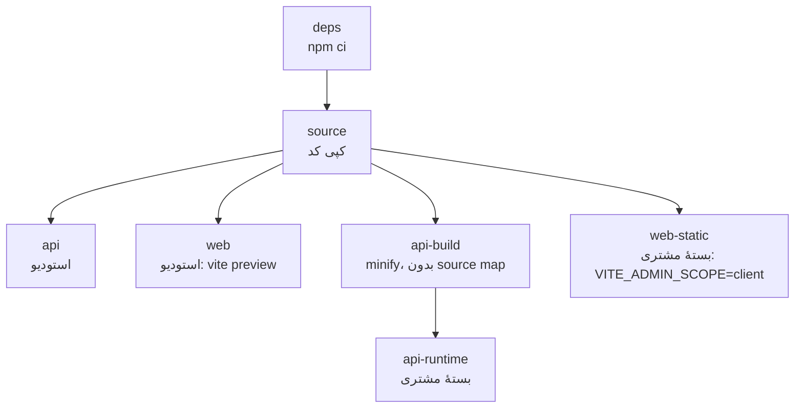

# ساخت و حالت‌های اجرا

> فصل ۲ — معماری · فایل‌ها: `Dockerfile`، `deploy/docker-compose.yml`، `deploy/export/docker-compose.yml`،
> `deploy/export/Caddyfile`، `apps/web/scripts/prerender.mjs`

## خلاصه
همهٔ imageها از **یک `Dockerfile`** ساخته می‌شوند و هر compose یکی از stageهای آن را انتخاب می‌کند.
یک کد واحد، بسته به چند متغیر محیطی، در سه حالت اجرا می‌شود.

## stageهای Dockerfile

| stage | برای | نکته |
|---|---|---|
| `api` | `sb-studio-api` | TypeScript کامپایل‌شده؛ شروع با `deploy/studio/api-start.sh` |
| `web` | `sb-studio-web` | `VITE_API_URL=same-origin`، `VITE_SITE_ID=""` (سایت از host خوانده می‌شود) |
| `api-runtime` | بستهٔ مشتری | فقط `dist` minifyشده، بدون `.d.ts` و source map؛ شروع با `deploy/cell/api-start.sh` |
| `web-static` | بستهٔ مشتری | فایل ایستا؛ آدرس API یک placeholder است که هنگام سرو شدن با آدرس واقعی جایگزین می‌شود |

`NPM_REGISTRY` (اختیاری) آدرس registry داخل `package-lock.json` را عوض می‌کند. نسخه‌ها و hashها همان
می‌مانند.

## سه حالت اجرا
| | استودیو | پیش‌نمایش سایت | سرور مشتری (cell) |
|---|---|---|---|
| آدرس | `admin.localhost` | `<slug>.preview.localhost` | دامنهٔ مشتری |
| سایت‌ها | همه | یکی (از host) | یکی (`CELL_SLUG`) |
| builder | دارد | — | ندارد (`VITE_ADMIN_SCOPE=client`) |
| ساختار سایت | اپراتور آزاد است | — | `clientLocked` |
| سرو وب | `vite preview` پشت nginx | همان | Caddy با فایل‌های ایستا |
| ایمیل و SMS | فقط در لاگ (`console`) | همان | تنظیمات مشتری (`panel`، SMTP، کاوه‌نگار) |

## متغیرهای مهم build در وب
| متغیر | اثر |
|---|---|
| `VITE_API_URL` | آدرس API. `same-origin` یعنی همان origin صفحه. خالی یعنی سایت با محتوای نمایشی و بدون پنل (`apiAvailable()`) |
| `VITE_SITE_ID` | سایت پیش‌فرض وقتی host از نوع preview نیست (بستهٔ مشتری) |
| `VITE_ADMIN_SCOPE=client` | builder، صفحه‌های platform، `__preview` و `__starter-preview` از bundle حذف می‌شوند |
| `SITE_URL` | برای prerender: آدرس canonical و sitemap |

## prerender برای SEO
`npm run build -w apps/web` بعد از `vite build`، `scripts/prerender.mjs` را اجرا می‌کند. این اسکریپت
برای هر صفحه، خدمت و محصول منتشرشده (فارسی و انگلیسی) یک `dist/<path>/index.html` می‌نویسد با
`<title>`، description، canonical، hreflang، Open Graph و `lang` و `dir` درست، به‌علاوهٔ `sitemap.xml`
و `robots.txt`. بدنهٔ صفحه را همچنان React در مرورگر می‌سازد. اگر API در زمان build در دسترس نباشد،
این قدم رد می‌شود.

روی سرور مشتری، Caddy `sitemap.xml` را از API زنده می‌گیرد
(`/api/v1/public/sites/<slug>/sitemap.xml`)، پس محصولات و صفحه‌های جدید مشتری هم در آن هستند.

## بستهٔ مشتری در اجرا
`deploy/export/docker-compose.yml` سه سرویس دارد:
- `db`: Postgres 16 در شبکهٔ داخلی،
- `api`: image ساخته‌شده (`API_IMAGE`) با `CELL_*`،
- `proxy`: Caddy. اگر `DOMAIN` دامنهٔ واقعی باشد گواهی HTTPS خودکار می‌گیرد؛ `:80` یعنی HTTP ساده.

Caddy مسیرهای `/api/*` و `/files/*` را به API می‌فرستد و بقیه را از `/srv/site` سرو می‌کند (با
fallback به `index.html` برای مسیرهای React).

در شروع، `deploy/cell/api-start.sh` اول migrate می‌کند و بعد `cell-bootstrap.js` را اجرا می‌کند. این
اسکریپت حساب اپراتور، حساب مالک و تنها سایتِ cell را می‌سازد. اگر از قبل وجود داشته باشند، دست
نمی‌خورند.

## اگر بخواهید…
- بدانید بسته چطور ساخته می‌شود → [تحویل به مشتری](../04-features/delivery.md)
- کد را فقط برای استودیو یا فقط برای مشتری فعال کنید: در وب `import.meta.env.VITE_ADMIN_SCOPE !== 'client'`
  (یا `OPERATOR_UI`) و در API `ctx.env.CELL_SLUG` را بررسی کنید. نمونه‌ها در `app/routes.tsx` و `app.ts` هستند.
