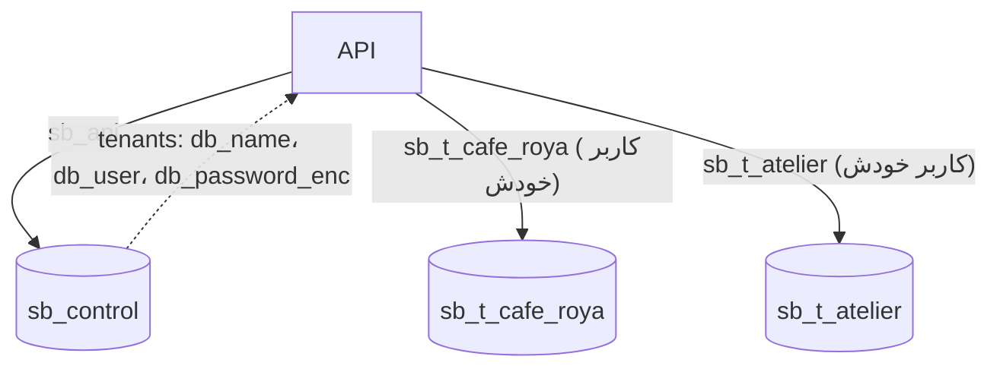

# چند-مستأجری: یک دیتابیس برای هر سایت

> فصل ۲ — معماری · فایل‌ها: `apps/api/src/modules/platform/provisioning.ts`، `apps/api/src/database/tenant/pools.ts`، `apps/api/src/context.ts`

## خلاصه
یک سرور Postgres دو نوع دیتابیس دارد:
- **`sb_control`**: یکی برای کل استودیو. کاربران، sessionها، فهرست سایت‌ها، عضویت‌ها، starterها و kitها.
- **`sb_t_<slug>`**: برای هر سایت یکی. صفحه‌ها، تنظیمات، محصولات، سفارش‌ها، درخواست‌ها، مشتری‌ها…

هر دیتابیس سایت **کاربر Postgres خودش** را دارد و بقیه حتی نمی‌توانند به آن وصل شوند.

## چرا این طراحی؟
- **جداسازی واقعی:** یک باگ در WHERE نمی‌تواند دادهٔ سایت دیگری را نشان دهد، چون اتصال به دیتابیس
  دیگری اصلاً وجود ندارد.
- **تحویل ساده:** برای بستهٔ مشتری، دیتابیس همان سایت dump می‌شود و چیزی جز همان سایت در آن نیست.
- **migration جدا:** هر سایت جدول `schema_migrations` خودش را دارد.

## ساختن یک سایت (provisioning)
`provisionTenant` قدم‌به‌قدم کار می‌کند. هر قدم را می‌شود بی‌خطر تکرار کرد و قدم فعلی در
`tenants.provisioning_step` ذخیره می‌شود:

| قدم | کار |
|---|---|
| ۱ | ثبت در `tenants` با وضعیت `provisioning` و یک رمز تصادفی رمزشده |
| ۲ | ساختن role مخصوص سایت (`LOGIN NOSUPERUSER NOCREATEDB NOCREATEROLE`) |
| ۳ | `CREATE DATABASE … OWNER <role>`، بعد `REVOKE ALL … FROM PUBLIC` و `GRANT CONNECT` فقط به همان role |
| ۴–۵ | اجرای migrationهای tenant و ساختن تنظیمات اولیه، با اتصال خود role سایت |
| ۶–۸ | مالک، دامنه و فعال‌سازی (`status = 'active'`) در یک تراکنش |

اگر قدمی شکست بخورد، سایت `active` نمی‌شود و خطای `provisioning_failed` برمی‌گردد. اجرای دوباره از
همان‌جا ادامه می‌دهد.

**دسترسی admin فقط اینجا:** اتصال `PG_ADMIN_URL` (کاربر `sb_admin`) فقط برای ساختن و حذف دیتابیس‌ها
استفاده می‌شود و هیچ handler معمولی به آن دسترسی ندارد.

## رمزهای دیتابیس سایت‌ها
رمز هر role در `tenants.db_password_enc` با **AES-256-GCM** و کلید `TENANT_SECRETS_KEY` رمز شده است
(`common/crypto.ts`). اگر این کلید عوض شود یا گم شود، API دیگر نمی‌تواند به هیچ سایتی وصل شود.
پس همیشه همراه backup نگهش دارید (داخل `deploy/.env` است).

## poolهای اتصال
`TenantPools` (`database/tenant/pools.ts`):
- برای هر سایت یک pool کوچک با `TENANT_POOL_SIZE` اتصال (پیش‌فرض ۵).
- حداکثر `TENANT_POOL_MAX_OPEN` pool باز (پیش‌فرض ۵۰). اگر به سقف برسد، poolی که از همه دیرتر
  استفاده شده بسته می‌شود.
- خطای اتصال idle، برنامه را از کار نمی‌اندازد.

## نام‌ها
| چیز | قاعده | مثال |
|---|---|---|
| slug | `slugSchema` در shared | `cafe-roya` |
| نام دیتابیس و role | `TENANT_DB_PREFIX` + slug با `_` به جای `-` | `sb_t_cafe_roya` |
| در تست‌ها | پیشوند `sb_test_` | `sb_test_site_ab12cd` |

## حذف سایت
`DELETE /api/v1/platform/tenants/:id?confirm=<slug>` (`deleteTenant`) فایل‌ها، دیتابیس، role و ردیف
سایت را پاک می‌کند. رابط کاربری قبلش slug را از شما می‌پرسد. برگشت‌پذیر نیست، مگر از backup.

## اگر بخواهید…
- جدول‌های هر دیتابیس را ببینید → [مدل داده](../03-layers/data-model.md)
- جدول جدیدی به همهٔ سایت‌ها اضافه کنید → [migration جدید](../05-recipes/new-migration.md)

## اشتباه‌های رایج
- ⚠️ بعد از کپی داده بین دیتابیس‌ها (restore، انتقال) `deploy/export/fix-sequences.sql` را اجرا کنید؛
  وگرنه انتشار صفحه با خطای 409 شکست می‌خورد.
- ⚠️ در کد handler هرگز به `ctx.control` برای دادهٔ سایت مراجعه نکنید؛ دادهٔ سایت فقط در `req.tenant.db` است.
