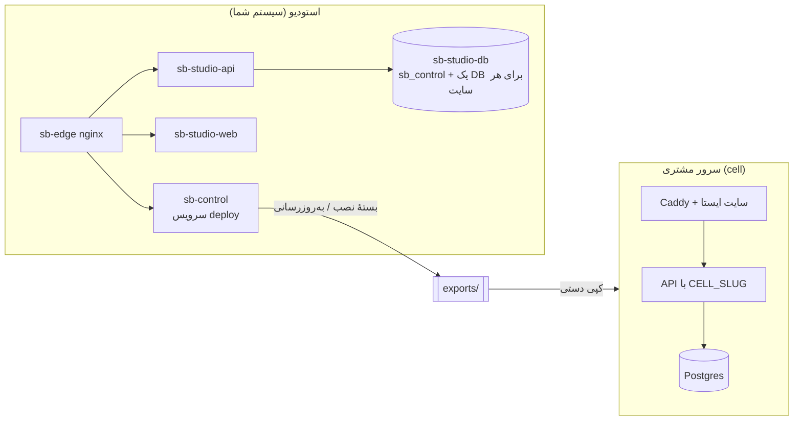
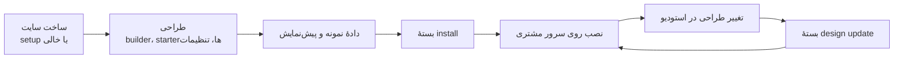

# نمای کلی معماری

> فصل ۲ — معماری · فایل‌ها: `deploy/docker-compose.yml`، `deploy/control/server.mjs`، `deploy/export/`

## خلاصه
سیستم سه بخش دارد:
1. **استودیو**: همهٔ سایت‌ها روی سیستم شما و با یک API، یک وب و یک سرور Postgres ساخته می‌شوند.
2. **سرویس deploy**: از هر سایت یک **بسته** می‌سازد.
3. **سرور مشتری**: بسته را نصب می‌کند و یک نسخهٔ مستقل و تک‌سایتی (cell) اجرا می‌کند.

## استودیو
| کانتینر | نقش | پورت |
|---|---|---|
| `sb-edge` | nginx؛ همهٔ آدرس‌ها از اینجا می‌گذرند | 80 |
| `sb-studio-api` | API (Express) | 4000 (فقط localhost، برای debug) |
| `sb-studio-web` | build وب، با `vite preview` سرو می‌شود | 5173 (فقط localhost) |
| `sb-studio-db` | Postgres 16؛ در شبکهٔ `studio` که `internal` است | — |
| `sb-control` | سرویس deploy؛ به Docker دسترسی دارد تا بسته بسازد | 8080 (فقط localhost) |

**یک build وب برای همه.** وب استودیو یک bundle است. اینکه کدام سایت نمایش داده شود از اسم host
خوانده می‌شود (`<slug>.preview.localhost`). روی `admin.localhost` هم پنل ادمین نمایش داده می‌شود.

**هر سایت، دیتابیس خودش.** API برای هر سایت یک دیتابیس جدا با کاربر Postgres جدا می‌سازد.
→ [چند-مستأجری](multi-tenancy.md)

**هر شروع API** (`deploy/studio/api-start.sh`) این سه کار را انجام می‌دهد:
1. اجرای migrationهای دیتابیس کنترل و همهٔ سایت‌ها،
2. تنظیم رمز اپراتور طبق `deploy/.env`،
3. اضافه کردن starterهای آماده‌ای که قبلاً اضافه نشده‌اند.

## سرویس deploy
http://admin.localhost/deploy/ یک برنامهٔ Node بدون وابستگی است (`deploy/control/server.mjs`) و فقط
اپراتور به آن دسترسی دارد. برای هر سایت دو نوع بسته می‌سازد:
- **install**: بار اول. شامل image ساخته‌شدهٔ API، سایت ایستا، دادهٔ سایت و فایل‌هایش.
- **design update**: صفحه‌ها، نسخه‌ها، تنظیمات طراحی، تعریف جدول‌ها و فایل‌های جدید را جایگزین
  می‌کند؛ دادهٔ خود مشتری (محصولات، سفارش‌ها، درخواست‌ها، تماس، آیتم‌های جدول‌ها) دست نمی‌خورد.

در هر لحظه فقط یک کار اجرا می‌شود. → [تحویل به مشتری](../04-features/delivery.md)

## سرور مشتری (cell)
بسته روی سرور مشتری سه سرویس اجرا می‌کند: Postgres، API (همان کد، فقط build شده) و Caddy که سایت
ایستا را سرو می‌کند. فرق API در اینجا:
- `CELL_SLUG` تنظیم شده است، پس **`clientLocked`** فعال است: مشتری فقط محتوا را عوض می‌کند و
  ساختار (افزودن یا جابه‌جایی سکشن، صفحهٔ جدید، طراحی) فقط کار اپراتور است.
- وب با `VITE_ADMIN_SCOPE=client` ساخته می‌شود و builder و صفحه‌های platform در آن نیستند.
- اپراتور از طریق SSO (`modules/auth/sso.ts`) وارد پنل مشتری می‌شود.

→ [ساخت و حالت‌های اجرا](builds.md)

## جریان کار اپراتور

## اگر بخواهید…
- ببینید یک درخواست HTTP کجاها می‌رود → [مسیر یک درخواست](request-path.md)
- بدانید چه کسی چه کاری می‌تواند بکند → [احراز هویت و نقش‌ها](auth.md)
