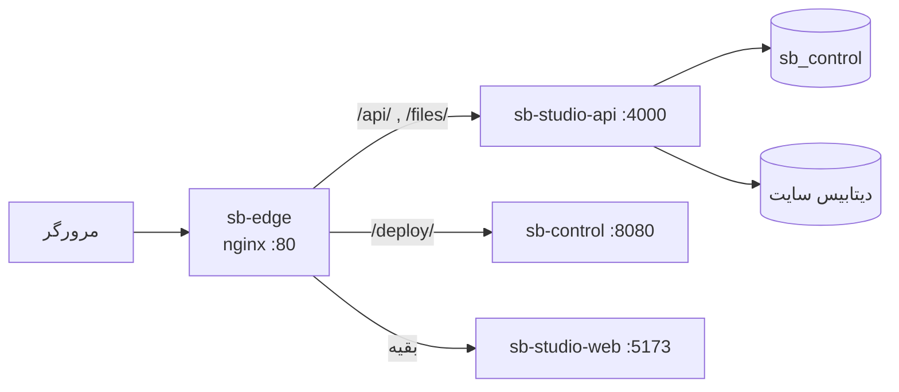
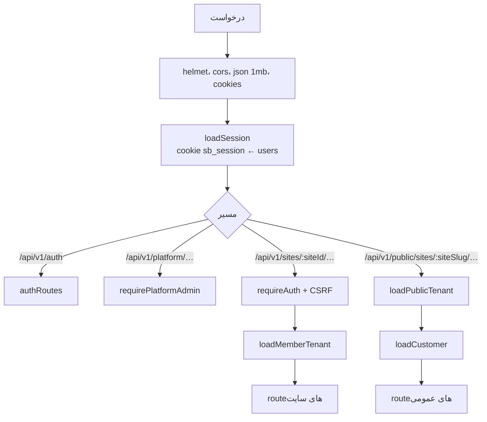

# مسیر یک درخواست

> فصل ۲ — معماری · فایل‌ها: `deploy/edge/nginx.conf`، `apps/api/src/app.ts`، `apps/api/src/middleware/tenant.ts`

## خلاصه
هر درخواستی که به استودیو می‌رسد اول از nginx (`sb-edge`) می‌گذرد. nginx بر اساس **مسیر** آن را به
یکی از سه سرویس می‌فرستد. اگر درخواست به API برسد، API از روی **slug** سایت در آدرس، دیتابیس همان
سایت را پیدا می‌کند.



## ۱. nginx
nginx فقط به این hostها جواب می‌دهد: `admin.localhost` و `<slug>.preview.localhost`.
`localhost` به `/admin` redirect می‌شود و برای هر host دیگر 404 برمی‌گرداند.

| مسیر | سرویس | توضیح |
|---|---|---|
| `/api/…` و `/files/…` | `studio-api:4000` | API و فایل‌های آپلودشده |
| `/deploy/…` | `control:8080` | فقط روی `admin.localhost`؛ روی پیش‌نمایش سایت‌ها 404 |
| بقیه | `studio-web:5173` | پنل ادمین و سایت عمومی (یک bundle) |

API و وب روی **یک origin** هستند (`VITE_API_URL=same-origin`). برای همین cookieها بدون تنظیم CORS
کار می‌کنند و وب درخواست‌ها را به `window.location.origin + /api/v1` می‌فرستد.

## ۲. وب: کدام سایت؟
`apps/web/src/features/public-site/data.ts`:
- اگر host به شکل `<slug>.preview.…` باشد، `slug` سایتِ نمایش‌داده‌شده است.
- اگر نه، `VITE_SITE_ID` (بستهٔ مشتری با همین مقدار build می‌شود).
- داده‌های عمومی از `/api/v1/public/sites/<slug>/…` خوانده می‌شوند.

## ۳. API: ترتیب middlewareها
`apps/api/src/app.ts`، به همان ترتیب اجرا:



| پیشوند | چه کسی | سایت از کجا می‌آید |
|---|---|---|
| `/api/v1/auth` | همه (ورود، خروج، فراموشی رمز) | — |
| `/api/v1/platform/…` | فقط اپراتور | — (کار روی همهٔ سایت‌ها) |
| `/api/v1/sites/:siteId/…` | عضو سایت یا اپراتور | `:siteId` = slug |
| `/api/v1/public/sites/:siteSlug/…` | بازدیدکننده (بدون ورود) و مشتری سایت | `:siteSlug` |
| `/api/v1/payments/callback/:siteSlug/:paymentId` | بازگشت از درگاه پرداخت | `:siteSlug` |
| `/api/v1/openapi.json` | همه | — |

## ۴. پیدا کردن دیتابیس سایت
`loadMemberTenant` در `middleware/tenant.ts`:
1. در آدرس `/api/v1/sites/:siteId/…`، مقدار `siteId` همان **slug** سایت است، نه id.
2. در جدول `tenants` دیتابیس کنترل دنبال slug می‌گردد. سایت باید `active` باشد.
3. دسترسی فقط از جدول `memberships` خوانده می‌شود، نه از چیزی که مرورگر می‌فرستد.
   کسی که عضو نیست **404** می‌گیرد (نه 403) تا نتواند وجود سایت‌ها را حدس بزند.
4. یک connection pool برای آن سایت از `ctx.tenantPools` گرفته می‌شود و در `req.tenant.db` قرار می‌گیرد.

```ts
// apps/api/src/middleware/tenant.ts
req.tenant = { id: tenant.id, slug: tenant.slug, name: tenant.name, db: poolFor(ctx, tenant), role, permissions };
```

از اینجا به بعد هر handler فقط با `req.tenant!.db` کار می‌کند و نمی‌تواند به دیتابیس سایت دیگری برسد.

## ۵. پاسخ
- موفق: `{ data, meta? }` (برای لیست‌ها `meta` شامل `page`، `pageSize`، `total`، `totalPages` است).
- بدون محتوا: `204`.
- خطا: `{ error: { code, message, details? } }`. → [API](../03-layers/api.md#خطاها)

## اگر بخواهید…
- مسیر جدیدی در API اضافه کنید → [دستورالعمل: مسیر API جدید](../05-recipes/new-api-route.md)
- بدانید چرا هر سایت دیتابیس جدا دارد → [چند-مستأجری](multi-tenancy.md)

## اشتباه‌های رایج
- ⚠️ بعد از تغییر کد، کانتینرها باید rebuild شوند؛ کد از دیسک خوانده نمی‌شود.
- ⚠️ اگر `/deploy/` روی آدرس پیش‌نمایش باز نمی‌شود، درست است: عمداً بسته شده.
- ⚠️ در تست یا اسکریپت، `admin.localhost` در Node.js resolve نمی‌شود؛ از `http://127.0.0.1:4000` استفاده کنید.
