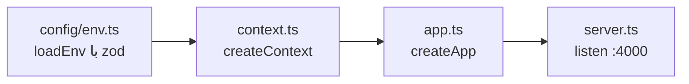

# API

> فصل ۳ — لایه‌ها · پوشه: `apps/api/src` · Express 5، `pg`، zod، pino

## خلاصه
- `app.ts` همهٔ routeها را وصل می‌کند.
- هر قابلیت یک پوشه در `modules/` دارد: `*.routes.ts` آدرس‌ها را تعریف می‌کند و `*.service.ts` منطق را.
- همهٔ routeها با `ApiRouter` تعریف می‌شوند. این کلاس ورودی را با zod اعتبارسنجی می‌کند و route را در
  OpenAPI ثبت می‌کند.
- SQL مستقیم با `pg` نوشته می‌شود و ORM وجود ندارد.

## شروع برنامه

`AppContext` (`context.ts`) تنها شیء مشترک است و به هر route داده می‌شود:

| فیلد | چیست |
|---|---|
| `env` | متغیرهای محیطی اعتبارسنجی‌شده (`config/env.ts`) |
| `control` | pool دیتابیس کنترل |
| `tenantPools` | poolهای دیتابیس سایت‌ها |
| `storage` | ذخیرهٔ فایل (`local` یا `s3`) |
| `email`، `sms` | فرستنده‌ها (`console` در محیط محلی) |
| `log` | logger از نوع pino |

اگر متغیر محیطی جدیدی لازم دارید، آن را به schema در `config/env.ts` اضافه کنید (با پیش‌فرض اگر
اختیاری است) و در `deploy/docker-compose.yml` و `deploy/export/docker-compose.yml` هم مقدار بدهید.

## تعریف route با `ApiRouter`
```ts
// apps/api/src/modules/leads/leads.routes.ts (کوتاه‌شده)
export function leadsRoutes(ctx: AppContext) {
  const r = new ApiRouter('/api/v1/sites/:siteId/leads', 'Requests', true); // base، تگ OpenAPI، نیاز به ورود
  r.router.use(requireModule('leads'));

  r.route(
    {
      method: 'get',
      path: '/',
      summary: 'List customer requests, newest activity first, with filters',
      query: paginationQuery.extend({ state: z.enum(['open', 'done', 'cancelled']).optional() }),
      middleware: [requirePermission('leads:read')],
    },
    async ({ req, query }) => {
      const { rows } = await req.tenant!.db.query('SELECT … LIMIT $1 OFFSET $2', [query.pageSize, (query.page - 1) * query.pageSize]);
      return { data: rows, meta: pageMeta(query.page, query.pageSize, total) };
    },
  );
  return r.router;
}
```

| گزینه | کار |
|---|---|
| `params`، `query`، `body` | schemaهای zod. ورودی parse می‌شود و اگر نامعتبر باشد `400 validation_failed` برمی‌گردد |
| `middleware` | قبل از handler اجرا می‌شود (`requirePermission`، `requireModule`، rate limit…) |
| `status` | کد پاسخ موفق (پیش‌فرض 200؛ برای ساختن 201) |
| `rawBody` | برای آپلود multipart که body را خودش می‌خواند |
| `auth` | فقط برای مستندات OpenAPI: امنیت route را جدا از router تعیین می‌کند |

handler یک `{ data, meta? }` برمی‌گرداند (json با `status`)، یا `undefined` (یعنی `204`).
اگر خودش `res` را فرستاده باشد (redirect، فایل)، چیز دیگری ارسال نمی‌شود.

**OpenAPI همیشه به‌روز است:** هر `r.route(...)` در `registry` ثبت می‌شود و
`GET /api/v1/openapi.json` از روی همان ساخته می‌شود. فهرست کامل و دقیق آدرس‌ها را آنجا ببینید.

کمکی‌های `common/http.ts`: `paginationQuery` (`page`، `pageSize` تا ۱۰۰)، `pageMeta`، `idParam`.

## خطاها
`common/errors.ts`:
```ts
throw notFound('Page');                 // 404 not_found
throw forbidden('Only the operator…');  // 403 forbidden
throw badRequest('…', details);         // 400 bad_request
throw conflict('…');                    // 409 conflict
throw new AppError(403, 'module_disabled', '…');
```
- `middleware/errors.ts` هر `AppError` را به `{ error: { code, message, details? } }` تبدیل می‌کند.
- `fromPgError` خطاهای constraint دیتابیس را تبدیل می‌کند: unique به 409، foreign key و check به 400.
- خطای ناشناخته 500 می‌شود و در لاگ ثبت می‌شود.
- API **کد** و **حدود** (`minimum`، `maximum`…) را می‌فرستد و وب آن‌ها را با
  `apps/web/src/lib/errorText.ts` به جملهٔ فارسی یا انگلیسی تبدیل می‌کند. پیام انگلیسی API به کاربر نشان
  داده نمی‌شود، پس برای خطای جدید یک `code` معنادار انتخاب کنید و متنش را در `errorText.ts` اضافه کنید.

## دسترسی به دیتابیس
| کجا | از چه استفاده کنید |
|---|---|
| دادهٔ یک سایت | `req.tenant!.db.query(sql, params)` |
| کاربران، سایت‌ها، starterها، kitها | `ctx.control.query(…)` |
| چند query که باید با هم انجام شوند | `withTransaction(db, async (client) => …)` (`database/tenant/pools.ts`) |
| ثبت رویداد | `auditTenant(db, {...})` / `auditPlatform(...)` (`modules/audit/audit.ts`) |

همیشه از پارامتر (`$1`، `$2`) استفاده کنید و هیچ‌وقت مقدار را مستقیم داخل رشتهٔ SQL نگذارید. شناسه‌های
Postgres (نام دیتابیس و role) فقط در `provisioning.ts` و با `ident()` ساخته می‌شوند.

نام ستون‌ها در دیتابیس snake_case و در JSON پاسخ camelCase است. تبدیل در خود SQL انجام می‌شود:
`created_at AS "createdAt"`.

## ماژول‌ها
| ماژول | آدرس پایه | چه می‌کند |
|---|---|---|
| `auth` | `/auth` | ورود، خروج، OTP، تأیید ایمیل و تلفن، SSO |
| `platform` | `/platform` | سایت‌ها (ساخت با setup، حذف، دادهٔ نمونه)، کاربران، audit، پیام‌رسانی (`messaging.ts`) |
| `bank` | `/platform/bank` | site kits |
| `starters` | `/platform/starters`، `/sites/:s/starters` | ذخیره، بررسی و اعمال starterها؛ starterهای آماده |
| `payments` | `/platform/payment-gateways`، `/sites/:s/payment-settings`، `/sites/:s/payments`، `/payments/callback` | درگاه‌ها، تراکنش‌ها، بازگشت از درگاه |
| `site` | `/sites/:s`، `/sites/:s/settings`، `/sites/:s/overview` | تنظیمات سایت، داشبورد |
| `pages` | `/sites/:s/pages` | صفحه‌ها، انتشار، نسخه‌ها |
| `catalog` | `/sites/:s/products`، `/sites/:s/services` | محصولات و خدمات |
| `collections` | `/sites/:s/collections` | جدول‌های محتوا و آیتم‌ها |
| `leads` | `/sites/:s/leads` | صندوق درخواست‌ها برای کارکنان |
| `orders` | `/sites/:s/orders` | سفارش‌ها |
| `customers` | `/sites/:s/customers` | حساب مشتریان (مسدود و آزاد کردن) |
| `shop` | `/sites/:s/shop`، عمومی | کوپن، نظرها، خبرنامه |
| `assets` | `/sites/:s/assets` | آپلود و فهرست فایل‌ها |
| `members` | `/sites/:s/members` | مالک و کارکنان، مجوزها |
| `public` | `/public/sites/:slug/…` | هرچه بازدیدکننده می‌خواند یا می‌فرستد |
| `interactions` | (داخل public) | فرم‌ها، حساب مشتری، پیگیری؛ سرویس مشترک درخواست‌ها |
| `audit` | — | تابع‌های ثبت رویداد |

## فایل‌ها (storage)
`storage/storage.ts`: کلید هر فایل `public/tenants/<tenantId>/<yyyy>/<mm>/<uuid>.<ext>` یا
`private/…` است. در driver `local`، `storage/files.routes.ts` فایل‌های public را مستقیم سرو می‌کند و
private را فقط با امضای معتبر و منقضی‌نشده (`STORAGE_SIGNING_KEY`). نوع فایل از محتوا تشخیص داده
می‌شود (`file-type`) و سقف حجم `UPLOAD_MAX_BYTES` است.

## CLI
`src/cli.ts` (در کانتینر: `node dist/cli.js …`): `migrate`، `create-admin`، `set-password`، `provision`،
`add-sample-starters`. → [Docker و اجرای روزانه](../06-operations/docker.md#cli-api)

## اگر بخواهید…
- route جدید بسازید → [دستورالعمل](../05-recipes/new-api-route.md)
- تست بنویسید → [نوشتن تست](../05-recipes/tests.md)
