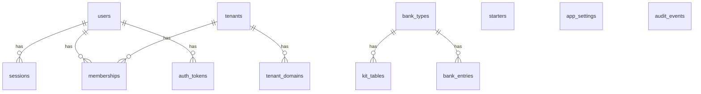
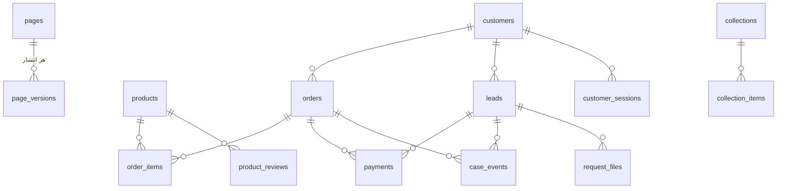

# مدل داده

> فصل ۳ — لایه‌ها · فایل‌ها: `apps/api/src/database/control-plane/migrations/*.sql`،
> `apps/api/src/database/tenant/migrations/*.sql`

## خلاصه
دو دیتابیس با دو مجموعه migration جدا (→ [چند-مستأجری](../02-architecture/multi-tenancy.md)).
این صفحه نقشهٔ جدول‌هاست. **منبع اصلی، خود فایل‌های SQL هستند.** اگر ستونی را دنبال می‌کنید،
در migrationها جست‌وجو کنید (`grep -n "column_name" apps/api/src/database/**/migrations/*.sql`)،
چون ستون‌ها در migrationهای بعدی اضافه شده‌اند.

## دیتابیس کنترل (`sb_control`)

| جدول | migration | چه نگه می‌دارد |
|---|---|---|
| `users` | 001 | همهٔ کاربران پنل؛ `is_platform_admin` یعنی اپراتور |
| `sessions` | 001 | sessionها؛ فقط `token_hash` و `csrf_hash` |
| `auth_tokens`، `otp_codes` | 001 | لینک‌های تأیید ایمیل و بازیابی رمز؛ کدهای SMS |
| `tenants` | 001، 002 | سایت‌ها: `slug`، `status`، `db_name`، `db_user`، `db_password_enc`، `provisioning_step`، `business_type` |
| `tenant_domains` | 001 | دامنه‌های هر سایت |
| `memberships` | 001 | عضویت کاربر در سایت: `role` (owner / staff) و `permissions` |
| `audit_events` | 001 | رویدادهای سطح platform |
| `bank_types`، `bank_kinds`، `bank_photos`، `bank_entries` | 002 | site kits: نوع سایت، لیست‌ها (محصول، خدمت، نظر، FAQ)، عکس‌ها |
| `app_settings` | 003 | تنظیمات کلی استودیو به شکل key/value: `payment_catalog`، `starter_samples`، `general_kit_seeded` |
| `starters`، `bank_hidden` | 004، 005 | starterها (`kind`، `group_name`، `sample_key`، `data`)؛ موارد پنهان‌شدهٔ kit |
| `kit_tables` | 006 | جدول‌های هر kit (کپی starter جدول با آیتم‌های نمونه) |

## دیتابیس هر سایت (`sb_t_<slug>`)

### تنظیمات و محتوا
| جدول | migration | چه نگه می‌دارد |
|---|---|---|
| `site_settings` | 001 | **یک ردیف** (`id = 1`) با ستون `settings` (jsonb): همهٔ تنظیمات سایت، طبق `siteSettingsSchema` |
| `pages` | 001 | صفحه‌ها: `slug`، `title`، `is_home`، `draft` (jsonb)، `published` (jsonb)، `published_version` |
| `page_versions` | 001 | کپی هر انتشار؛ برای تاریخچه و بازگردانی |
| `assets` | 001 | فایل‌های آپلودشده: `storage_key`، `visibility` (public / private)، `kind`، `alt` |
| `collections` | 006 | تعریف جدول‌های محتوا: `slug`، `fields` (jsonb)، `detail_page`، `commerce`، `request_type` |
| `collection_items` | 006 | آیتم‌ها: `slug`، `title`، `data` (jsonb)، `status`، `position` |

### فروشگاه
| جدول | migration | چه نگه می‌دارد |
|---|---|---|
| `products` | 001، 004، 010 | محصول: `price_minor`، `stock`، `category`، `variants`، … |
| `services` | 001 | خدمات |
| `orders`، `order_items` | 001، 005، 007، 010 | سفارش و اقلامش؛ `customer_id`، `payment_method`، `unread` |
| `coupons`، `product_reviews`، `subscribers` | 010 | کد تخفیف، نظرها (منتظر تأیید)، خبرنامه |
| `payment_settings` | 002، 011 | فقط `allow_cod` (پرداخت در محل) باقی مانده |
| `payment_gateways` | 011 | هر درگاه یک ردیف: `provider`، `allowed`، `enabled`، `sort`، `label`، `credentials`، `test_mode` |
| `payments` | 002، 007 | هر تلاش پرداخت: `order_id` یا `lead_id`، `provider`، `status`، `authority`، `ref_id` |

### درخواست‌ها و مشتریان
| جدول | migration | چه نگه می‌دارد |
|---|---|---|
| `leads` | 001، 004، 007 | درخواست‌ها: `type`، `number` (کد `R<number>`)، `status` (مرحله)، `stage_kind`، `details`، `amount_due_minor`، `paid_minor`، `unread`، `customer_id` |
| `case_events` | 007 | خط زمانی درخواست یا سفارش: `kind`، `public`، `body`، `by_customer` |
| `request_files` | 008 | فایل‌هایی که با فرم آپلود شده‌اند (خصوصی) |
| `customers`، `customer_sessions`، `customer_codes` | 007 | حساب مشتریان سایت و کدهای یک‌بارمصرف |
| `audit_events` | 001 | رویدادهای همین سایت (`auditTenant`) |

## قراردادهای مشترک
- **کلید اصلی** `uuid` با `gen_random_uuid()`. شمارهٔ قابل‌خواندن جدا است (`orders.number`، `leads.number`).
- **مبلغ‌ها** با پسوند `_minor` و به کوچک‌ترین واحد پول ذخیره می‌شوند (برای IRR، ریال).
- **متن دوزبانه** به شکل jsonb `{ "en": "…", "fa": "…" }` است (`localizedSchema`).
- **دادهٔ نمونه** ستون `demo boolean` دارد (migration 009). همه با هم حذف می‌شوند و در بستهٔ install
  نمی‌روند، مگر اپراتور بخواهد (`deploy/export/drop-demo.sql`).
- **jsonb ترتیب کلیدها را نگه نمی‌دارد.** JSONها را همیشه ساختاری مقایسه کنید، نه به‌صورت متن.

## کجا تعریف می‌شود چه چیزی در jsonb است؟
| ستون | schema در shared |
|---|---|
| `site_settings.settings` | `siteSettingsSchema` (`schemas.ts`) + بخش‌های `siteOptions.ts` |
| `pages.draft` / `published` | `pageDocumentSchema` (`schemas.ts`)؛ props هر سکشن در `sectionDefinitions` (`sections.ts`) |
| `collections.fields` | `collectionInputSchema` (`collections.ts`) |
| `starters.data` | `starterPackSchema` (`starters.ts`) |

## اگر بخواهید…
- ستون یا جدول اضافه کنید → [migration جدید](../05-recipes/new-migration.md)
- تنظیم جدیدی به سایت اضافه کنید (بدون migration) → [تنظیم جدید برای سایت](../05-recipes/new-site-setting.md)

آخرین migration تننت اکنون 015_members_and_reviews.sql است: نوع حساب/سازمان، مالک آیتم،
مالک فایل مشتری، تخصیص درخواست به آیتم و جدول نظرات آیتم. migration روی schema اعضای نصب‌های
قدیمی که با نام 012_members_and_reviews.sql تحویل شده‌اند هم بدون ساخت تکراری کار می‌کند.
