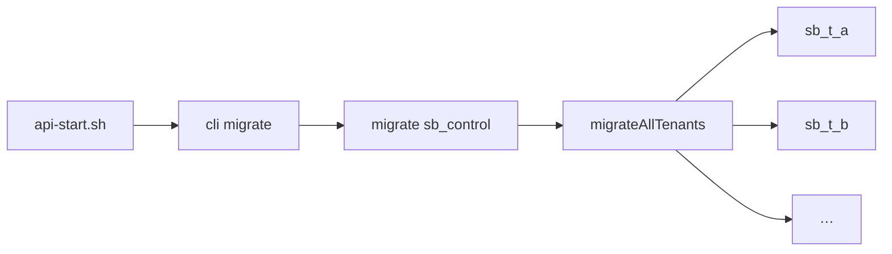

# migrationها

> فصل ۳ — لایه‌ها · فایل‌ها: `apps/api/src/database/migrator.ts`، `apps/api/src/cli.ts`، `deploy/studio/api-start.sh`

## خلاصه
- migrationها فایل‌های SQL شماره‌دار هستند و در دو پوشه قرار دارند:
  - `control-plane/migrations/` برای `sb_control`. آخرین: `006_kit_tables.sql`.
  - `tenant/migrations/` برای هر سایت. آخرین: `011_payment_gateways.sql`.
- در هر شروع API (`node dist/cli.js migrate`) اول دیتابیس کنترل و بعد **همهٔ سایت‌ها** migrate می‌شوند.
- **migrationی که اجرا شده را هرگز ویرایش نکنید.** همیشه یک فایل جدید با شمارهٔ بعدی بسازید.

## migrator چطور کار می‌کند
`migrate()` در `migrator.ts`:
1. یک **advisory lock** می‌گیرد تا دو پروسه هم‌زمان یک دیتابیس را migrate نکنند.
2. جدول `schema_migrations (name, checksum, applied_at)` را در صورت نبودن می‌سازد.
3. برای هر migration اجراشده checksum فایل را دوباره حساب می‌کند. اگر فایل تغییر کرده باشد، با خطای
   `Migration … was modified after it was applied` متوقف می‌شود.
4. هر migration اجرانشده را به ترتیب نام و **هر کدام در یک تراکنش** اجرا می‌کند. اگر شکست بخورد،
   rollback می‌شود، ثبت نمی‌شود و خطا بالا می‌رود.

سایت جدید هم موقع ساخت (`provisionTenant`) همهٔ migrationهای tenant را می‌گیرد. روی سرور مشتری هم
`deploy/cell/api-start.sh` همین `migrate` را اجرا می‌کند. پس بستهٔ design update که API جدیدتری
دارد، دیتابیس مشتری را خودش به‌روز می‌کند.

## قواعد نوشتن
- نام فایل: `NNN_short_name.sql` با شمارهٔ سه‌رقمی بعدی.
- طوری بنویسید که روی دیتابیسی که **داده دارد** هم درست اجرا شود (سایت‌های موجود و سرورهای مشتری):
  مقدار پیش‌فرض بدهید یا دادهٔ قدیمی را در همان migration منتقل کنید.
  نمونه: `011_payment_gateways.sql` درگاه قبلی هر سایت را به جدول جدید منتقل می‌کند و بعد ستون‌های
  قدیمی را حذف می‌کند.
- در صورت امکان `IF NOT EXISTS` بنویسید.
- `BEGIN` و `COMMIT` ننویسید؛ migrator خودش تراکنش را باز می‌کند.
- اگر ستون jsonb اضافه می‌کنید، schema آن را در `packages/shared` تعریف کنید.

## تست
تست‌های API دیتابیس‌های تازه می‌سازند و همهٔ migrationها را روی آن‌ها اجرا می‌کنند. پس اگر migration
خطا داشته باشد، `npm test` شکست می‌خورد. برای منطق انتقال داده یک تست جدا بنویسید.

→ [دستورالعمل: migration جدید](../05-recipes/new-migration.md)

## اشتباه‌های رایج
- ⚠️ ویرایش یک migration اجراشده باعث می‌شود API استودیو بالا نیاید (خطای checksum). تغییر را برگردانید و
  یک migration جدید بنویسید.
- ⚠️ migration tenant که فقط روی دیتابیس خالی کار می‌کند، روی سرور مشتری شکست می‌خورد.
