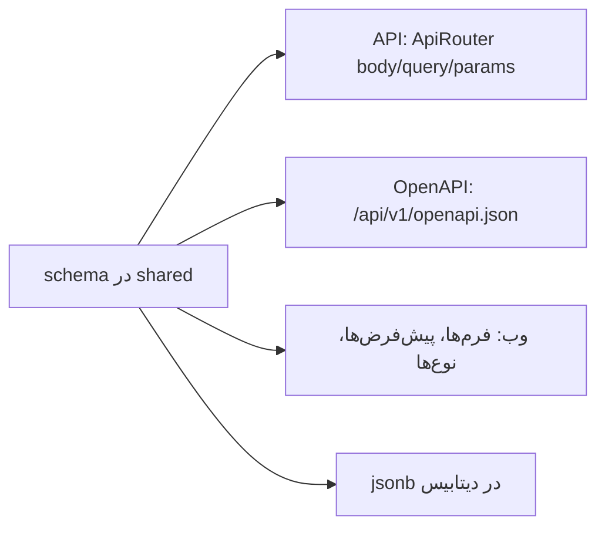

# پکیج shared

> فصل ۳ — لایه‌ها · پوشه: `packages/shared/src` (import با `@site-builder/shared`)

## خلاصه
هر داده‌ای که بین وب و API رد و بدل می‌شود، **یک‌بار و فقط اینجا** با zod تعریف می‌شود:
- API هر ورودی را با همین schemaها parse می‌کند،
- وب فرم‌ها و پیش‌فرض‌ها را از همین‌ها می‌گیرد،
- منطق خالصی که هر دو طرف لازم دارند (مثلاً محاسبهٔ مبلغ فرم، تبدیل نسخه‌های قدیمی) هم اینجاست.



shared هیچ وابستگی به Express، React یا دیتابیس ندارد و فقط کد خالص TypeScript است.

## فایل‌ها
| فایل | مهم‌ترین چیزها |
|---|---|
| `constants.ts` | `MEMBERSHIP_ROLES`، `PERMISSIONS`، `TENANT_STATUSES`، `FORM_TYPES`، ماژول‌ها |
| `schemas.ts` | `slugSchema`، `localizedSchema`، `siteSettingsSchema`، `withSettingDefaults`، `pageDocumentSchema`، `pageInputSchema`، `productInputSchema`، `orderInputSchema`، `leadInputSchema`، `paymentGatewayInputSchema`، `couponInputSchema` |
| `sections.ts` | `sectionDefinitions` (props هر نوع سکشن)، `defaultProps`، `parseSectionProps`، `normalizedProps`، `contentOnlyChange`، `SYSTEM_PAGES` |
| `siteOptions.ts` | `designSchema` (فونت و رنگ)، `headerSchema`، `footerSchema`، `formFieldSchema`، `FORM_FIELD_TYPES`، `shopPageSchema`، `systemPagesSchema` |
| `collections.ts` | `collectionInputSchema` (۱۵ نوع فیلد)، فیلترها، فیلترهای بازدیدکننده، بلوک‌های باکس، `COLLECTION_PRESETS` |
| `interactions.ts` | request typeها، workflowها، `WORKFLOW_PRESETS`، حساب مشتری، `computeTotal` |
| `forms.ts` | تبدیل فرم‌های نسخهٔ ۱ به نسخهٔ ۲ هنگام خواندن |
| `setup.ts` | `siteSetupSchema`، `SETUP_FORMS`، `setupRequestType` |
| `bank.ts` | site kits: `BUILT_IN_KINDS` |
| `starters.ts` | `starterPackSchema` (نسخهٔ ۲)، `readStarterPack` (تبدیل داده‌های قدیمی) |

## تنظیمات سایت: یک سند بزرگ
`siteSettingsSchema` همهٔ تنظیمات سایت را تعریف می‌کند و در `site_settings.settings` ذخیره می‌شود.
گروه‌های اصلی:

| گروه | چه دارد |
|---|---|
| `name`، `tagline`، `logoAssetId`، `contact`، `social` | برند و تماس |
| `defaultLocale`، `locales`، `direction`، `calendar`، `errorLanguage`، `adminLanguage` | زبان و جهت |
| `themeId`، `design`، `accentColor` | ظاهر |
| `nav`، `header`، `footer`، `announcement`، `popup` | منو و قاب صفحه |
| `modules` | روشن و خاموش بودن بخش‌ها |
| `requestTypes`، `formOptions`، `notifications`، `accounts` | فرم‌ها، workflow، اعلان‌ها، حساب مشتری |
| `productCategories`، `shop`، `shopPage`، `cardDesigns` | فروشگاه و باکس‌ها |
| `systemPages`، `texts`، `seo`، `meta`، `exportOptions` | صفحه‌های داخلی، متن‌های ثابت، SEO، کد صفحه، تحویل |

### `withSettingDefaults`: سازگاری با سایت‌های قدیمی
گروه‌های اختیاری در شیء `optionSchemas` (`schemas.ts`) فهرست شده‌اند. هنگام خواندن تنظیمات،
`withSettingDefaults` برای هر گروهی که وجود ندارد یا parse نمی‌شود **پیش‌فرض** را می‌گذارد. به همین
دلیل سایتی که قبل از یک قابلیت ساخته شده، بدون migration همان ظاهر قبلی را دارد. API در
`GET /settings` و وب در `useSiteSettings` همین تابع را صدا می‌زنند.

> تنظیم جدید = یک کلید اختیاری با `.default(…)` در schema + افزودن آن به `optionSchemas`.
> → [دستورالعمل](../05-recipes/new-site-setting.md)

## سند صفحه
```ts
// pageDocumentSchema (ساده‌شده)
{ schemaVersion: 1, sections: [{ id: 's1', type: 'hero', hidden?: false, props: { … } }] }
```
- `sectionSchema` فقط شکل کلی و اندازه را بررسی می‌کند.
- props هر نوع با `parseSectionProps(type, props)` و بر اساس `sectionDefinitions[type]` + `appearanceSchema`
  (فاصله، پس‌زمینه…) اعتبارسنجی می‌شود و پیش‌فرض‌ها پر می‌شوند.
- `normalizedProps` شکل‌های قدیمی را به شکل جدید تبدیل می‌کند (مثلاً یک دکمهٔ `cta` به آرایهٔ `buttons`).

۲۰ نوع سکشن: `page-header`، `hero`، `rich-text`، `image-text`، `features`، `stats`، `services`،
`products`، `gallery`، `testimonials`، `faq`، `pricing`، `cta`، `collection-list`، `collection-item`،
`system-page`، `map`، `video`، `newsletter`، `contact-form`.

## الگوی «نسخهٔ قدیمی هنگام خواندن تبدیل می‌شود»
در این پروژه به‌جای migration روی jsonb، شکل قدیمی **هنگام خواندن** به شکل جدید تبدیل می‌شود:

| داده | تابع تبدیل |
|---|---|
| props سکشن | `normalizedProps` |
| فرم نسخهٔ ۱ | `upgradeRequestType` (`forms.ts`) داخل `withSettingDefaults` |
| starter قدیمی `{document}` | `readStarterPack` |

## build
`package.json` پکیج سه ورودی دارد: `types` و `source` به `src/index.ts`، و `default` به `dist/index.js`.
- **وب** (Vite، `apps/web/vite.config.ts`) و typecheck مستقیم سورس را می‌خوانند و build لازم ندارند.
- **API در اجرا** از `dist` می‌خواند. پس در Docker اول `npm run build -w packages/shared` اجرا می‌شود.
  در `npm run dev:api` و تست‌ها، `--conditions=source` باعث می‌شود سورس خوانده شود.

## اگر بخواهید…
- بدانید API چطور از این schemaها استفاده می‌کند → [API](api.md)
- سکشن جدید بسازید → [نوع سکشن جدید](../05-recipes/new-section.md)
