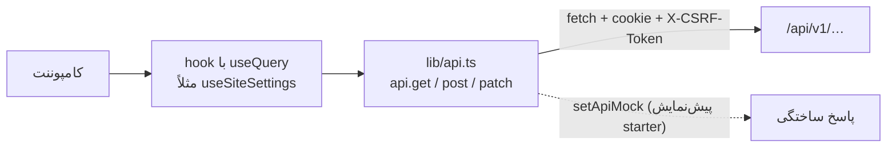
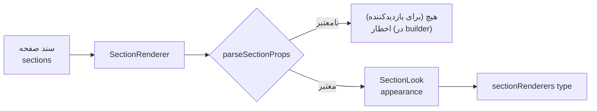
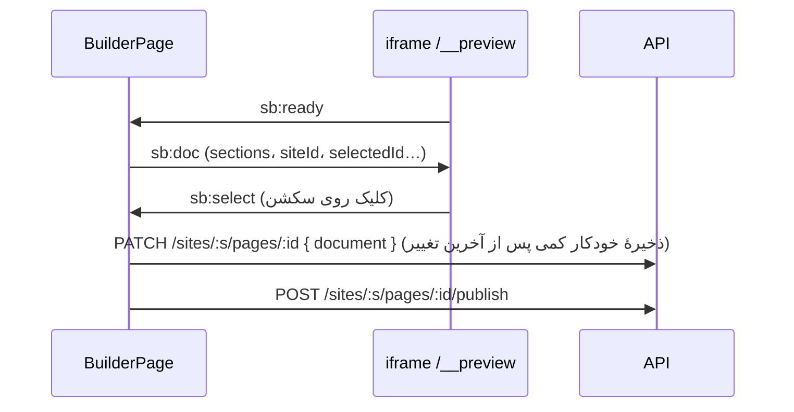

# وب

> فصل ۳ — لایه‌ها · پوشه: `apps/web/src` · React 19، Vite، Tailwind 4، TanStack Query، React Router 7

## خلاصه
یک برنامهٔ React که سه کار انجام می‌دهد:
1. **سایت عمومی** هر مشتری: صفحه‌ها، فروشگاه، حساب مشتری.
2. **پنل ادمین** در `/admin`: تنظیمات، صندوق درخواست‌ها، سفارش‌ها و…
3. **builder** (فقط در استودیو): ویرایش صفحه با پیش‌نمایش زنده.

پنل و builder به‌صورت lazy load می‌شوند تا سایت عمومی سبک بماند. در build مشتری
(`VITE_ADMIN_SCOPE=client`) builder و صفحه‌های platform اصلاً داخل bundle نیستند.

## مسیرها
`app/routes.tsx`:

| مسیر | چه چیزی |
|---|---|
| `/admin/*` | `AdminRoot` (lazy) |
| `/reset-password`، `/verify-email` | لینک‌های ایمیل |
| `/__preview` | iframe پیش‌نمایش builder (فقط استودیو) |
| `/__starter-preview` | پیش‌نمایش starterها (فقط استودیو) |
| `/` | صفحهٔ اصلی سایت (`SitePage home`) |
| `/products`، `/products/:slug`، `/services`، `/services/:slug` | صفحه‌های داخلی فروشگاه و خدمات |
| `/cart`، `/checkout`، `/checkout/result` | سبد و پرداخت |
| `/account`، `/track`، `/track/:code` | حساب مشتری و پیگیری |
| `/wishlist` | علاقه‌مندی‌ها |
| `/:slug` | صفحهٔ ساخته‌شده در builder |
| `/:collection/:item` | صفحهٔ یک آیتم از جدول محتوا (مثلاً `/classes/yoga`) |
| `*` | 404 |

صفحه‌های داخلی داخل `<BuiltInPage page="…">` قرار دارند. اگر سایت یک صفحهٔ منتشرشده با slug ثابت آن
صفحه داشته باشد (مثلاً `products`)، همان صفحهٔ builder نشان داده می‌شود و محتوای داخلی درون سکشن
`system-page` قرار می‌گیرد. → [صفحات داخلی](../04-features/system-pages.md)

### پنل ادمین
`admin/AdminRoot.tsx`:
- `/admin/login`، `/admin/forgot`
- `/admin/platform/*` (`PlatformPages`، فقط اپراتور): سایت‌ها، کاربران، audit، starterها، site kits، درگاه‌ها
- `/admin/sites/:siteId/*` (`SitePages`): صفحه‌ها، محتوا، محصولات، خدمات، جدول‌ها و آیتم‌ها،
  درخواست‌ها (`leads`)، سفارش‌ها، مشتریان، کوپن‌ها، نظرها، مشترکان، فایل‌ها، اعضا، تنظیمات، درگاه‌ها، تراکنش‌ها
- `/admin/sites/:siteId/pages/:pageId/builder` (فقط اپراتور)

منوی کناری هر سایت در `SiteNav` داخل `AdminRoot.tsx` است.

## دریافت داده

- **`lib/api.ts`**: `api.get/post/put/patch/delete` پاسخ `data` را برمی‌گردانند و `api.page` کل پاسخ را
  (همراه `meta`). خطاها `ApiError` با `status`، `code` و `details` هستند.
- **hookهای سایت عمومی**: `features/public-site/data.ts` (`useSiteSettings`، `usePublishedPageList`…)؛
  کلید query به شکل `['public', site, …]`.
- **hookهای پنل** کنار صفحه‌ها تعریف شده‌اند (مثلاً `admin/collections/api.ts`).
- بعد از هر تغییر، `queryClient.invalidateQueries` با همان کلید صدا زده می‌شود تا داده دوباره خوانده شود.
- **سایت جاری:** `useSiteId()` از `SiteIdContext`؛ مقدار پیش‌فرض از host یا `VITE_SITE_ID` می‌آید.
- **بدون API** (`VITE_API_URL` خالی): سایت با `content/fallback` نمایش داده می‌شود و پنل در دسترس نیست.

## رندر سکشن‌ها

- `sections/renderers.tsx`: جدول `sectionRenderers` (هر `type` یک کامپوننت). سکشن‌های جدول محتوا در
  `collectionSections.tsx` و رسانه در `mediaSections.tsx` هستند.
- `SectionRenderer` هر سکشن را در یک error boundary می‌گذارد، پس سکشن خراب بقیهٔ صفحه را از کار
  نمی‌اندازد.
- در صفحهٔ قالبِ آیتم جدول، `{{field}}` در هر متنی با مقدار آیتم جایگزین می‌شود (`useItemTokens`).

## builder
`admin/builder/`:

| فایل | کار |
|---|---|
| `BuilderPage.tsx` | صفحهٔ اصلی: لیست سکشن‌ها (کشیدن و رها کردن با dnd-kit)، افزودن، ذخیره، انتشار |
| `state.ts` | reducer: `add`، `remove`، `duplicate`، `move`، `update`، `toggleHidden`، `undo`/`redo` (تا ۱۰۰ قدم؛ ویرایش‌های پشت‌سرهم یک سکشن در کمتر از ۱ ثانیه یک قدم حساب می‌شوند) |
| `fields.ts` | `sectionMeta`: نام، توضیح و **فیلدهای ویرایشگر** هر نوع سکشن (`FieldDef`) |
| `Inspector.tsx` | فرم تنظیمات سکشن انتخاب‌شده، ساخته‌شده از `FieldDef`ها؛ و ظاهر (`AppearanceEditor`) |
| `PreviewFrame.tsx` | داخل iframe `/__preview`؛ سند را با `postMessage` می‌گیرد و با استایل خود سایت رندر می‌کند |
| `CardDesigner.tsx`، `CollectionFields.tsx` | طراح باکس و فیلدهای مخصوص منبع داده |

پیش‌نمایش در iframe است تا عرض واقعی موبایل، تبلت و دسکتاپ و CSS خود سایت را داشته باشد.
پیام‌ها فقط از همان origin پذیرفته می‌شوند.

## ظاهر و تم
- `styles/index.css`: tokenهای رنگ (`--bg`، `--surface`، `--ink`، `--accent`…) برای هر
  `[data-theme="…"]` که Tailwind آن‌ها را به کلاس‌هایی مثل `bg-bg` و `text-ink-soft` تبدیل می‌کند.
- طراحی سفارشی سایت (`settings.design`: فونت‌ها، رنگ‌ها) با `lib/siteLook.tsx` اعمال می‌شود.
- در کامپوننت‌ها رنگ ثابت ننویسید؛ از کلاس‌های token استفاده کنید تا همهٔ تم‌ها درست کار کنند.

## زبان و جهت
- متن‌های دوزبانه درون کد: `L('English', 'فارسی')` (`admin/interactions/common.tsx`) یک `{ en, fa }`
  می‌سازد و `useL()` نسخهٔ زبان جاری را برمی‌گرداند. بعضی فایل‌ها `l({ en, fa })` محلی دارند.
- متن‌های مشترک پنل در `admin/i18n.ts` هستند (`useT()`).
- متن‌های سایت عمومی در `locales/en.ts` و `locales/fa.ts` هستند و `settings.texts` می‌تواند آن‌ها را عوض کند.
- زبان و جهت جاری از `lib/preferences.tsx` (`usePreferences()`) می‌آیند.
- تاریخ‌ها با `lib/calendar.ts` (شمسی یا میلادی) نمایش داده می‌شوند.
- خطاهای API با `lib/errorText.ts` به جمله تبدیل می‌شوند.

## اگر بخواهید…
- سکشن جدید بسازید → [نوع سکشن جدید](../05-recipes/new-section.md)
- صفحهٔ جدیدی به پنل اضافه کنید: کامپوننت را در `admin/pages/` بسازید، در `SitePages.tsx` (یا
  `PlatformPages.tsx`) یک `<Route>` بدهید و در `SiteNav` لینکش را بگذارید. اگر فقط برای اپراتور است،
  با `operator` یا `OPERATOR_UI` محدودش کنید **و** در API هم.

### ناوبری پایین موبایل
در تنظیمات هدر، گزینهٔ ناوبری موبایل بین منوی کشویی و نوار پایین انتخاب می‌شود.
`header.mobileNavigation` و `header.mobileLinks` در schema مشترک ذخیره می‌شوند.
آیتم‌ها عنوان دوزبانه، مقصد و آیکن دارند؛ حداکثر چهار آیتم و گزینهٔ بیشتر برای منوی کامل.
`MobileBottomNav` از سبد و حساب موجود استفاده می‌کند؛ portal و فاصلهٔ safe-area مانع پوشاندن محتوا می‌شوند.
در حالت نوار پایین، هدر موبایل در جریان صفحه و sticky است تا فرم حساب زیر آن نرود؛
سبد و حساب در هدر تکرار نمی‌شوند. نمایش دسکتاپ و حالت کشویی حفظ می‌شود.
در حالت نوار پایین موبایل، data-app-navigation روی main فاصلهٔ تیترهای مشترک و صفحات
حساب و پیگیری را ۲۴ پیکسل و فاصلهٔ هروی قاب‌دار را ۱۶ پیکسل می‌کند؛ فاصلهٔ اضافی
هدر ثابت دیگر لازم نیست. قواعد به عرض کمتر از ۱۰۲۴ محدود هستند.
در بخش آمار و ارقام، چیدمان «کارت مربعی با آیکن» سه ستون هم‌اندازه می‌سازد. آیکن هر مورد
در ویرایشگر قابل انتخاب است؛ حالت نوشتهٔ ساده پیش‌فرض می‌ماند. مقادیر و عنوان‌ها تغییر نمی‌کنند.

مرجع عمومی تنظیمات ظاهر فروشگاه: [طراحی موبایل و کارت‌ها](../../features/mobile-storefront.md).
راهنمای عملی برای اپراتور: [طراحی فروشگاه برای موبایل](../../guide/mobile-storefront.md).
این گزینه‌ها به Android یا یک نصب مت‌استک وابسته نیستند؛ جزئیات پوستهٔ APK در سند همان اپ است.
