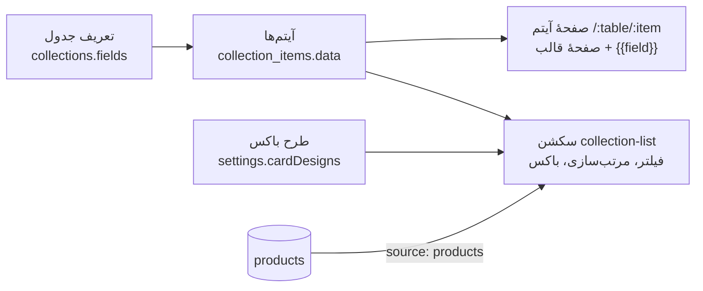

# جدول‌های محتوا (collections)

> فصل ۴ — قابلیت‌ها · shared: `collections.ts` · API: `modules/collections/` · وب: `admin/collections/`،
> `admin/builder/CardDesigner.tsx`، `features/collections/`، `sections/collectionSections.tsx` ·
> جدول‌ها: `collections`، `collection_items` (migration 006) · خلاصهٔ انگلیسی: [`docs/features/collections.md`](../../features/collections.md)

## خلاصه
اپراتور برای هر سایت **جدول** تعریف می‌کند (دوره‌ها، کلاس‌ها، اخبار، پروژه‌ها…) و مالک **آیتم‌ها** را
اضافه می‌کند. آیتم‌ها در صفحه‌ها با سکشن «List from a table» (`collection-list`) و در صفحهٔ هر آیتم
با «Item display» (`collection-item`) نشان داده می‌شوند.

## تعریف جدول
`collectionInputSchema` (shared):
- `slug`، `name`، `itemName`
- `fields`: هر فیلد یک `key`، برچسب و نوع دارد. ۱۵ نوع وجود دارد: `text`، `textarea`، `number`،
  `price`، `date`، `datetime`، `boolean`، `select`، `multiselect`، `image`، `gallery`، `link`،
  `email`، `phone`، `reference` (اشاره به آیتمی از جدول دیگر با slug). `text` و `textarea` دوزبانه‌اند.
- `detailPage`: slug صفحهٔ قالبی که هر آیتم با آن نمایش داده می‌شود.
- `imageField`: فیلد عکس اصلی.
- `commerce`: فروش آیتم‌ها (`capacityField` برای ظرفیت، `deadlineField` برای مهلت).
- `requestType`: فرم درخواست مرتبط.
- `COLLECTION_PRESETS`: جدول‌های آماده برای شروع سریع.

داده‌های هر آیتم در `collection_items.data` (jsonb) و با کلید فیلدها ذخیره می‌شوند.

## آدرس‌های API
| آدرس | کار | محدودیت |
|---|---|---|
| `GET/POST /sites/:s/collections` | فهرست و ساخت جدول | ساخت: در cell فقط اپراتور + `site:write` |
| `GET/PUT/DELETE /sites/:s/collections/:id` | یک جدول | تغییر ساختار: همان |
| `GET/POST /sites/:s/collections/:id/items` | آیتم‌ها | `catalog:write` برای نوشتن |
| `GET/PUT/DELETE /sites/:s/collections/:id/items/:itemId` | یک آیتم | همان |
| `GET /sites/:s/collections/preview/:source` | پیش‌نمایش لیست در builder | — |
| `GET /public/sites/:s/collections` | جدول‌ها برای بازدیدکننده | — |
| `GET /public/sites/:s/collections/:table/items` | لیست با فیلتر، مرتب‌سازی، صفحه‌بندی، جست‌وجو | — |
| `GET …/:table/range`، `…/:table/days` | کمترین و بیشترین مقدار (برای slider) و روزهای دارای آیتم (برای تقویم) | — |
| `GET …/:table/items/:slug` | یک آیتم | — |

فیلتر و مرتب‌سازی **در SQL** انجام می‌شود (`collections.service.ts`)، نه در مرورگر. ظرفیت و مهلت هم
روی سرور بررسی می‌شوند.

## لیست و باکس
سکشن `collection-list` این‌ها را دارد: منبع (یک جدول یا `products`)، فیلترهای ثابت، فیلترهای
بازدیدکننده، مرتب‌سازی، شبکه یا لیست، تعداد ستون برای هر دستگاه، صفحه‌بندی و جست‌وجو.

**فیلترهای بازدیدکننده** بسته به نوع فیلد: جست‌وجو، chip، select، checkbox، slider، بازه، presetها،
تقویم (درون صفحه یا در پنجره)، بازهٔ تاریخ، و «فقط موجودها». فیلترها کنار هم یا زیر هم نمایش داده می‌شوند.

**باکس** هر آیتم با طراح باکس (`CardDesigner.tsx`) ساخته و با `CardView.tsx` رندر می‌شود. گزینه‌ها:
اندازه و برش عکس، چند عکس (شبکه، اسلایدر، ردیف)، جهت و چینش، و دکمه‌ها (مشاهده، سبد، درخواست، لینک،
تماس). طرح‌های مشترک در `settings.cardDesigns` ذخیره می‌شوند (مثلاً `box-products`، `box-<table>`).
هر لیست می‌تواند `card` اختصاصی هم داشته باشد.

## صفحهٔ آیتم
مسیر `/:collection/:item` (`features/collections/CollectionItemPage.tsx`) صفحهٔ `detailPage` جدول را
رندر می‌کند:
- هر `{{field}}` در هر متنی از سکشن‌ها با مقدار آیتم جایگزین می‌شود (`useItemTokens` در `SectionRenderer.tsx`).
- سکشن `collection-item` خود آیتم را نشان می‌دهد.
- لیست‌های مرتبط می‌توانند با `valueFrom: 'current'` بر اساس آیتم جاری فیلتر شوند.

## فروش و درخواست
- آیتم با `commerce` به سبد خرید اضافه می‌شود (`order_items.collection_item_id`) و ظرفیت و مهلت روی
  سرور کنترل می‌شوند.
- دکمهٔ «درخواست» فرم را با `?item=<table>/<slug>` باز می‌کند و آیتم در `leads.item_ref` ثبت می‌شود.

## در تحویل
design update **تعریف جدول‌ها** را جایگزین می‌کند و **آیتم‌های مشتری** را نگه می‌دارد. جدولی که برای
مشتری تازه است، آیتم‌های استودیو را هم می‌گیرد.

## اگر بخواهید…
- نوع فیلد جدید اضافه کنید:
  1. آن را به `FIELD_TYPES` اضافه کنید و اعتبارسنجی مقدارش را در shared بنویسید،
  2. ویرایشگرش را در `admin/collections/ItemsPage.tsx` بسازید،
  3. نمایشش را در `CardView.tsx` بنویسید،
  4. اگر قابل فیلتر است، SQL فیلترش را در `collections.service.ts` اضافه کنید،
  5. سازندهٔ مقدار نمونه را در `platform/setup/demo.ts` (`fieldValue`) اضافه کنید.

  `npm run typecheck` جاهایی را که روی همهٔ نوع‌ها switch دارند نشانتان می‌دهد.

## پروفایل خودخدمت و نظرات
نوع حساب می‌تواند profileTable داشته باشد تا مشتری یک آیتم متعلق به خود را مدیریت کند.
آپلود تصویر/PDF با مالکیت مشتری کنترل می‌شود و آیتم جدید برای تأیید کارکنان پیش‌نویس می‌ماند.
کارکنان درخواست را به آیتم مربی تخصیص می‌دهند؛ جدول می‌تواند نظر را به درخواست تکمیل‌شده محدود کند.
بلوک‌های list و rating و سکشن item-reviews به طراح اضافه شده‌اند. migration شمارهٔ 015 است تا
با شمارهٔ 012 اینستاگرام تداخل نکند و نصب قدیمی که schema اعضا را دارد نیز قابل ارتقا باشد.
