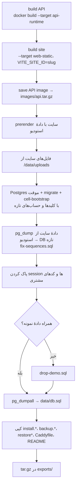

# تحویل به مشتری

> فصل ۴ — قابلیت‌ها · فایل‌ها: `deploy/control/server.mjs`، `deploy/export/`، `deploy/cell/api-start.sh`،
> `apps/api/src/cell-bootstrap.ts` · خلاصهٔ انگلیسی: [`docs/features/studio-and-delivery.md`](../../features/studio-and-delivery.md)

## خلاصه
سرویس deploy (http://admin.localhost/deploy/) برای هر سایت یک فایل `exports/<name>.tar.gz` می‌سازد.
در هر لحظه فقط یک کار اجرا می‌شود و قبل از بازنویسی بسته‌ای که وجود دارد سؤال می‌پرسد. فقط اپراتور
وارد این صفحه می‌شود (با همان session استودیو).

## بستهٔ install

نکته‌ها:
- **بدون کد منبع:** فقط build minifyشدهٔ API و فایل‌های ایستای سایت در بسته قرار می‌گیرند.
- **کلیدهای تازه:** دیتابیس سرور مشتری کلیدها و رمزهای خودش را دارد. اطلاعات ورود و تنظیمات هر سایت در
  volume `control-data` سرویس deploy نگه داشته می‌شود تا بستهٔ بعدی همان را استفاده کند.
- **حساب‌ها:** `SITE_OPERATOR_*` و `SITE_OWNER_*` از `deploy/.env`. اگر خالی باشند، برای هر سایت
  ساخته می‌شوند.
- **sessionهای استودیو و کدهای یک‌بارمصرف** هیچ‌وقت به سرور مشتری نمی‌روند.

روی سرور مشتری: `install.sh`، `install.ps1` یا `install.cmd`. این اسکریپت آدرس و پورت‌ها را نشان
می‌دهد. راهنمای داخل بسته: `deploy/export/README.md`.

## بستهٔ design update
فقط **طراحی** را می‌برد:

| جایگزین می‌شود | دست نمی‌خورد (مال مشتری) |
|---|---|
| `pages`، `page_versions` | محصولات، خدمات، دسته‌ها |
| تعریف `collections` (جدول‌هایی که در استودیو نیستند حذف می‌شوند) | آیتم‌های جدول‌ها (جدول تازه آیتم‌های استودیو را می‌گیرد) |
| `assets` جدید (`ON CONFLICT DO NOTHING`) | سفارش‌ها، درخواست‌ها، مشتریان، پرداخت‌ها |
| تنظیمات طراحی در `site_settings` | نام، شعار، لوگو، تماس، `notifications` |
| image جدید API (migrationها خودکار اجرا می‌شوند) | حساب‌ها |

روی سرور مشتری: `update.sh`، `update.ps1` یا `update.cmd` (`deploy/export/UPDATE.md`). اگر مشتری
متن یا عکس صفحه‌ها را عوض کرده باشد، با نسخهٔ استودیو **جایگزین** می‌شود.

## سرور مشتری در اجرا
→ [ساخت و حالت‌های اجرا](../02-architecture/builds.md)

- backup مشتری: `backup.sh` یا `backup.ps1`. بازگردانی: `restore.sh` / `restore-db.sh`.
- اپراتور با SSO وارد پنل مشتری می‌شود (`CELL_SSO_SECRET`).

## اگر بخواهید…
- چیز جدیدی را جزء «طراحی» کنید (یعنی با design update برود): آن را به بخش design update در
  `server.mjs` اضافه کنید و مطمئن شوید دادهٔ مشتری را بازنویسی نمی‌کند. بعد این جدول را به‌روز کنید.
- جدول جدیدی در دیتابیس سایت ساختید: تصمیم بگیرید دادهٔ نمونه دارد یا نه. اگر دارد، ستون `demo` بدهید
  و آن را به `deploy/export/drop-demo.sql` اضافه کنید.

## اشتباه‌های رایج
- ⚠️ build بسته به Docker و registry npm نیاز دارد؛ اگر شکست خورد، `NPM_REGISTRY` را بررسی کنید.
- ⚠️ لاگ هر کار در صفحهٔ deploy نمایش داده می‌شود. قدمی که شکست خورده آنجا مشخص است.
