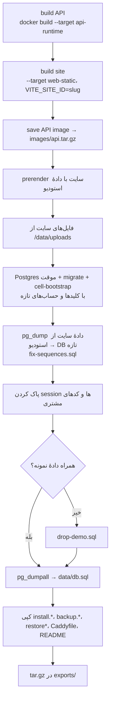

# تحویل به مشتری

> فصل ۴ — قابلیت‌ها · فایل‌ها: `deploy/control/server.mjs`، `deploy/export/`، `deploy/cell/api-start.sh`،
> `apps/api/src/cell-bootstrap.ts` · خلاصهٔ انگلیسی: [`docs/features/studio-and-delivery.md`](../../features/studio-and-delivery.md)

## خلاصه
سرویس deploy (http://admin.localhost/deploy/) برای هر سایت یک فایل `exports/<name>.tar.gz` می‌سازد.
در هر لحظه فقط یک کار اجرا می‌شود و قبل از بازنویسی بسته‌ای که وجود دارد سؤال می‌پرسد. فقط اپراتور
وارد این صفحه می‌شود (با همان session استودیو).

## بستهٔ install

نکته‌ها:
- **بدون کد منبع:** فقط build minifyشدهٔ API و فایل‌های ایستای سایت در بسته قرار می‌گیرند.
- **کلیدهای تازه:** دیتابیس سرور مشتری کلیدها و رمزهای خودش را دارد. اطلاعات ورود و تنظیمات هر سایت در
  volume `control-data` سرویس deploy نگه داشته می‌شود تا بستهٔ بعدی همان را استفاده کند.
- **حساب‌ها:** `SITE_OPERATOR_*` و `SITE_OWNER_*` از `deploy/.env`. اگر خالی باشند، برای هر سایت
  ساخته می‌شوند.
- **sessionهای استودیو و کدهای یک‌بارمصرف** هیچ‌وقت به سرور مشتری نمی‌روند.

روی سرور مشتری: `install.sh`، `install.ps1` یا `install.cmd`. این اسکریپت آدرس و پورت‌ها را نشان
می‌دهد. راهنمای داخل بسته: `deploy/export/README.md`.

## بستهٔ design update
فقط **طراحی** را می‌برد:

| جایگزین می‌شود | دست نمی‌خورد (مال مشتری) |
|---|---|
| `pages`، `page_versions` | محصولات، خدمات، دسته‌ها |
| تعریف `collections` (جدول‌هایی که در استودیو نیستند حذف می‌شوند) | آیتم‌های جدول‌ها (جدول تازه آیتم‌های استودیو را می‌گیرد) |
| `assets` جدید (`ON CONFLICT DO NOTHING`) | سفارش‌ها، درخواست‌ها، مشتریان، پرداخت‌ها |
| تنظیمات طراحی در `site_settings` | نام، شعار، لوگو، تماس، `notifications` |
| image جدید API (migrationها خودکار اجرا می‌شوند) | حساب‌ها |

روی سرور مشتری: `update.sh`، `update.ps1` یا `update.cmd` (`deploy/export/UPDATE.md`). اگر مشتری
متن یا عکس صفحه‌ها را عوض کرده باشد، با نسخهٔ استودیو **جایگزین** می‌شود.

## سرور مشتری در اجرا
→ [ساخت و حالت‌های اجرا](../02-architecture/builds.md)

- backup مشتری: `backup.sh` یا `backup.ps1`. بازگردانی: `restore.sh` / `restore-db.sh`.
- اپراتور با SSO وارد پنل مشتری می‌شود (`CELL_SSO_SECRET`).

## اگر بخواهید…
- چیز جدیدی را جزء «طراحی» کنید (یعنی با design update برود): آن را به بخش design update در
  `server.mjs` اضافه کنید و مطمئن شوید دادهٔ مشتری را بازنویسی نمی‌کند. بعد این جدول را به‌روز کنید.
- جدول جدیدی در دیتابیس سایت ساختید: تصمیم بگیرید دادهٔ نمونه دارد یا نه. اگر دارد، ستون `demo` بدهید
  و آن را به `deploy/export/drop-demo.sql` اضافه کنید.

## اشتباه‌های رایج
- ⚠️ build بسته به Docker و registry npm نیاز دارد؛ اگر شکست خورد، `NPM_REGISTRY` را بررسی کنید.
- ⚠️ لاگ هر کار در صفحهٔ deploy نمایش داده می‌شود. قدمی که شکست خورده آنجا مشخص است.

## بازگرداندن بستهٔ مشتری به سازنده
پنل داخل بستهٔ مشتری فقط محتوا را تغییر می‌دهد. برای ویرایش طراحی، کپی مستقلی در استودیو
ثبت می‌شود؛ دیتابیس نصب فعال مستقیماً به سازنده متصل نمی‌شود. schemaها قبل از انتقال بررسی
و شناسهٔ مسیر فایل‌ها بازنویسی می‌شود. مشتری، سفارش، پرداخت و session وارد نمی‌شوند.
مراحل فنی و ابزارها در [studio-import.md](../../features/studio-import.md) ثبت شده‌اند.
پس از ویرایش، Save پیش‌نویس است؛ Publish نسخه‌ای را تعیین می‌کند که در خروجی بیلد می‌رود.
برای نصب موجود، در «پیش‌نمایش و استقرار» بستهٔ به‌روزرسانی طراحی بسازید؛ نصب کامل برای سرور تازه است.
این کار sync دائمی نیست؛ تغییر محتوای مشتری پس از کپی باید قبل از آپدیت بررسی شود.

بیلد client در Dockerfile از VITE_API_URL=same-origin استفاده می‌کند تا پنل خصوصی و سایت عمومی،
هرکدام API را از مبدا خود بخوانند. تثبیت دامنهٔ عمومی در بیلد، API پنل خصوصی را به مسیرهای
مسدود عمومی می‌فرستد. نشانی API استودیو برای prerender جداگانه تنظیم می‌شود.

## سایت و پنل مشتری با یک مبدا
سایت و پنل /admin روی یک دامنه و پورت ارائه می‌شوند؛ ساخت client از API هم‌مبدا استفاده می‌کند.
در تنظیمات Matstack نیز با تأیید مالک، مسیرهای ورود و مدیریت از همان دامنهٔ عمومی عبور می‌کنند؛
احراز هویت و مجوزهای API حفظ شده و سازندهٔ استودیو به بستهٔ مشتری اضافه نشده است.
پورت‌های جداگانهٔ ۸۷۲۷ و ۸۷۳۷ و override ادمین حذف شدند. CORS_ORIGINS در compose خروجی
قابل تنظیم است و پیش‌فرض SITE_URL را دارد. اسکریپت‌های لوکال آدرس عمومی و localhost همان پورت
را ثبت می‌کنند. یک پاسخ HTML موفق برای تأیید ورود کافی نیست؛ خود صفحهٔ ورود و API باید کار کنند.

## استقرار تک‌سایت در لیارا
قالب deploy/liara یک کانتینر با Caddy روی پورت ۸۰ و API روی ۴۰۰۰ می‌سازد؛ سایت و پنل
/admin هم‌مبدا هستند. PostgreSQL سرویس جدا در همان شبکه خصوصی است و uploads دیسک پایدار دارد.
ریشهٔ کانتینر می‌تواند فقط‌خواندنی باشد؛ فایل‌های وب در /tmp آماده می‌شوند. این مسیر فعلاً
اپراتوری است و دکمهٔ لیارا به داشبورد فعلی اضافه نشده است. راهنما: features/liara-delivery.md.
پایگاه ابری موجود با نصب تازه یکی نیست؛ آپدیت صریح طراحی، داده‌های کسب‌وکار را حفظ می‌کند.
خروجی INSERT باید نام ستون‌ها را داشته باشد. پیش از نسخهٔ جدید طراحی، snapshot داده‌ها روی
دیسک خصوصی نوشته می‌شود؛ این جایگزین بکاپ کامل سرویس PostgreSQL نیست.

## خروجی امضاشدهٔ اندروید
اپ کافه در mobile/cafe-mohammad یک WebView برای دامنهٔ تولید است و به تونل لوکال وابسته نیست.
اسکریپت build.ps1 با -Release کلید و رمزها را از signing.json خصوصی در var/android-signing می‌خواند
و فقط APK امضاشده را در exports می‌گذارد. کلید و تنظیمات رمز خارج از گیت و جدا از فایل ارسالی
به فروشگاه نگه‌داری می‌شوند؛ برای نسخه‌های بعد همان کلید و versionCode بالاتر لازم است.
بیلد debug امضای دیگری دارد و نصب release روی آن به حذف نسخهٔ debug نیاز دارد.

## تأیید زندهٔ مالکیت دامنه (اینماد)
در تنظیمات سایت ← کد صفحه، آیکون، اعلان و پاپ‌آپ، بخش «تأیید مالکیت دامنه (اینماد)»
برای مشتری و اپراتور در دسترس است. meta.enamadCode فقط کد عددی را می‌پذیرد. پس از ذخیره،
مسیر /CODE.txt از API همان سایت فایل خالی و بدون کش برمی‌گرداند؛ تغییر یا حذف کد بلافاصله
اثر می‌کند و به انتشار یا بیلد نیاز ندارد. کدهای HTML همچنان فقط در اختیار اپراتورند.
قالب‌های Caddy خروجی و لیارا و nginx پیش‌نمایش، این مسیر را پیش از فایل‌های ثابت به API می‌فرستند.
نسخه‌های قدیمی به یک‌بار به‌روزرسانی API، پنل و پراکسی نیاز دارند؛ سایت‌های جدید قابلیت را
در بستهٔ تحویلی دریافت می‌کنند. این مرحله تأیید مالکیت است، نه تکمیل همهٔ مراحل دریافت اینماد.

## اپ مدیریت کافه
پروژهٔ mobile/cafe-mohammad-admin اپی مستقل با شناسهٔ ir.cafemohammad.admin است که /admin
دامنهٔ تولید را باز می‌کند. شناسه و داده‌های محلی آن از اپ مشتری جداست؛ هر دو کنار هم نصب
می‌شوند. نام فارسی و آیکن تیره/نارنجی آن را متمایز می‌کند. کلید امضا همان کلید خصوصی کافه
است ولی رمز ورود به پنل داخل اپ قرار ندارد. ساخت با build.ps1 -Release در پوشهٔ همین پروژه
انجام می‌شود؛ فایل APK خروجی در exports قرار می‌گیرد. راهنما و محدودیت‌ها در README پروژه‌اند.

## تحویل خصوصی اپلیکیشن‌ها به مالک
بخش «اپلیکیشن‌های موبایل» در /admin/sites/:slug/mobile-apps دو جایگاه اپ اصلی و مدیریت دارد.
اپراتور با حساب platform admin فایل APK و نسخه را بارگذاری یا حذف می‌کند؛ مالک همان سایت
دکمهٔ دانلود دارد. کارمند و مالک سایت دیگر اجازه ندارند؛ دانلود حتی برای اپراتور از مسیر
مالک مجاز نیست. کنترل مجوز در API هر درخواست انجام می‌شود و لینک عمومی یا امضاشده ساخته
نمی‌شود. فایل خارج از کتابخانهٔ عادی assets در فضای خصوصی نگه‌داری می‌شود. جدول mobile_apps
در migration016 ساخته می‌شود؛ نسخه‌های بعدی با بارگذاری فایل جدید، بدون استقرار منتشر می‌شوند.
صحت امضا و شناسهٔ APK را اپراتور پیش از بارگذاری بررسی می‌کند؛ API فقط ساختار APK را می‌سنجد.

## کد اعلان مخصوص پنل
meta.adminHeadCode از headCode عمومی جداست. فقط اپراتور آن را تنظیم می‌کند؛ در خروجی عمومی
HTML یا تنظیمات عمومی برنمی‌گردد. AdminPanelCode آن را پس از ورود مالک، اپراتور یا کارمند
دارای orders:read همان سایت فعال می‌کند. مهمان و صفحهٔ ورود SDK را اجرا نمی‌کنند. این کار
ثبت‌نام دریافت اعلان را محدود می‌کند؛ ارسال Push باید بعداً گیرندگان مجاز را در سرور مشخص
کند و عضویت‌هایی که قبلاً در سرویس ساخته شده‌اند خودکار حذف نمی‌شوند.
