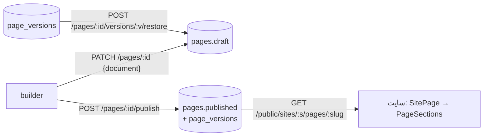

# صفحات و سکشن‌ها

> فصل ۴ — قابلیت‌ها · API: `modules/pages/pages.routes.ts`، `modules/public/public.routes.ts` ·
> shared: `schemas.ts` (`pageDocumentSchema`)، `sections.ts` · وب: `admin/builder/`، `sections/`،
> `features/public-site/pages/SitePage.tsx` · جدول‌ها: `pages`، `page_versions`

## خلاصه
هر صفحه یک **سند JSON** است: فهرستی مرتب از سکشن‌ها. هر صفحه دو نسخه دارد:
- **draft** (پیش‌نویس) که builder مدام ذخیره‌اش می‌کند،
- **published** که بازدیدکننده می‌بیند.

با هر انتشار یک **نسخه** در `page_versions` ثبت می‌شود و می‌شود آن را بعداً به draft برگرداند.

## جریان داده

## آدرس‌های API
| آدرس (`/api/v1/sites/:siteId/pages…`) | کار | محدودیت |
|---|---|---|
| `GET /` | فهرست صفحه‌ها با وضعیت انتشار | — |
| `POST /` | صفحهٔ جدید (به‌صورت draft) | `pages:write`، در cell فقط اپراتور |
| `PUT /order` | ترتیب صفحه‌ها | همان |
| `PATCH /:id` | عنوان، slug، SEO، سند، صفحهٔ اصلی | `pages:write`؛ مشتری در cell فقط سند، و فقط متن و تصویر |
| `POST /:id/publish` | انتشار draft | `pages:write` |
| `POST /:id/unpublish` | پنهان کردن از بازدیدکننده | در cell فقط اپراتور |
| `GET /:id/versions` | نسخه‌های منتشرشده | — |
| `POST /:id/versions/:version/restore` | کپی یک نسخه به draft | — |
| `DELETE /:id` | حذف (به‌جز صفحهٔ اصلی) | در cell فقط اپراتور |

عمومی: `GET /api/v1/public/sites/:slug/pages` (فهرست منتشرشده‌ها برای منو و sitemap) و
`GET …/pages/:slug` (سند منتشرشده).

## قواعد
- **یک صفحهٔ اصلی:** index یکتای `pages_single_home` تضمین می‌کند فقط یک `is_home` وجود داشته باشد.
  `isHome: false` رد می‌شود؛ باید صفحهٔ دیگری را اصلی کنید.
- **slug:** حروف کوچک انگلیسی، عدد و خط تیره (`CHECK` در جدول).
- **انتشار** draft را در `published` کپی می‌کند، `published_version` را یکی بالا می‌برد، نسخه را ثبت
  می‌کند و رویداد audit `page.published` می‌نویسد. همهٔ این‌ها در یک تراکنش انجام می‌شوند.
- **`hasUnpublishedChanges`** در پاسخ می‌گوید draft با published فرق دارد یا نه.

## سکشن‌ها: سه جای تعریف
هر نوع سکشن در سه جا تعریف می‌شود. نام `type` در هر سه یکی است:

| کجا | چه چیزی |
|---|---|
| shared `sections.ts` → `sectionDefinitions` | schema کامل props و پیش‌فرض‌ها؛ API و وب هر دو با آن اعتبارسنجی می‌کنند |
| وب `sections/renderers.tsx` → `sectionRenderers` | کامپوننتی که سکشن را نمایش می‌دهد |
| وب `admin/builder/fields.ts` → `sectionMeta` | نام، توضیح و فیلدهای ویرایشگر در builder |

TypeScript هر سه را به `SectionType` گره زده است. اگر نوعی در shared اضافه کنید و renderer یا meta آن
را ننویسید، `npm run typecheck` خطا می‌دهد. → [دستورالعمل: نوع سکشن جدید](../05-recipes/new-section.md)

**ظاهر (appearance)** برای همهٔ سکشن‌ها مشترک است (`appearanceSchema`: فاصله، پس‌زمینه…) و
`SectionLook` آن را اعمال می‌کند.

## منو و لینک‌ها
منوی سایت از صفحه‌ها ساخته نمی‌شود؛ در `settings.nav` و `settings.header` / `settings.footer` ذخیره
می‌شود. انتخاب لینک در پنل از `admin/links.tsx` (`useLinkGroups`) می‌آید: صفحه‌ها، صفحه‌های داخلی،
جدول‌ها و آیتم‌ها. اگر slug صفحه‌ای را عوض کنید، لینک‌های منو خودکار عوض نمی‌شوند. (اعمال starter
slugها را همه‌جا عوض می‌کند، ولی تغییر دستی slug این کار را نمی‌کند.)

## قفل مشتری
در cell، `PATCH` فقط `document` را از مشتری می‌پذیرد و `contentOnlyChange(draftقبلی, سندجدید)` باید
`null` برگرداند. یعنی تعداد، ترتیب، نوع و پنهان بودن سکشن‌ها و کلیدهای ساختاری نباید عوض شوند و فقط
متن و تصویر تغییر کند. → [احراز هویت و نقش‌ها](../02-architecture/auth.md#قفل-مشتری-در-cell-clientlocked)

## تست
`apps/api/test/content.test.ts`: draft در برابر published، نسخه‌ها، بازگردانی، قفل مشتری.

## اگر بخواهید…
- صفحه‌های فروشگاه و حساب را قابل ویرایش کنید → [صفحات داخلی](system-pages.md)
- از یک صفحهٔ آماده شروع کنید → [starterها](starters.md)

در منوی موبایل، لینک پیش‌فرض خانه فقط وقتی اضافه می‌شود که در منوی تنظیم‌شده لینک / وجود نداشته باشد. اگر خانه در تنظیمات هست، همان عنوان و ترتیب حفظ می‌شود (MobileMenu.tsx).
