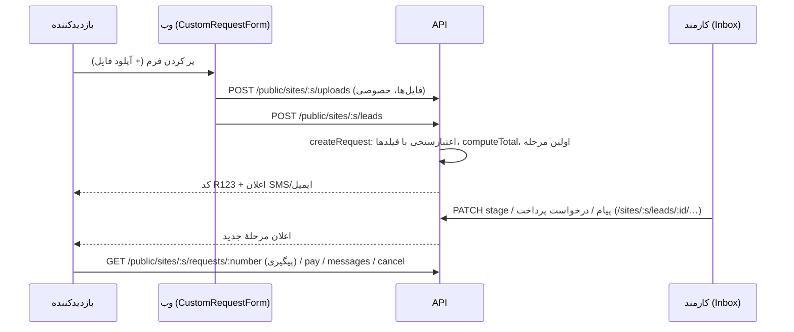

# فرم‌ها، workflow، حساب مشتری و پیگیری

> فصل ۴ — قابلیت‌ها · shared: `interactions.ts`، `forms.ts`، `siteOptions.ts` (`formFieldSchema`) ·
> API: `modules/interactions/`، `modules/leads/`، `modules/customers/` · وب: `admin/interactions/`،
> `admin/pages/InboxPages.tsx`، `features/leads/`، `features/account/` · جدول‌ها: `leads`، `case_events`،
> `request_files`، `customers` (migrationهای 007 و 008) · خلاصهٔ انگلیسی: [`docs/features/interactions.md`](../../features/interactions.md)

## خلاصه
هر **نوع درخواست** (مشاوره، رزرو، دمو…) در `settings.requestTypes` تعریف می‌شود و سه بخش دارد:
- **فرم**: سؤال‌ها،
- **workflow**: مراحلی که درخواست طی می‌کند،
- **دسترسی و اعلان‌ها**.

هر درخواست ارسال‌شده یک ردیف در `leads` می‌شود، با کد پیگیری `R<number>`، یک خط زمانی
(`case_events`) و در صورت نیاز پرداخت (`payments.lead_id`).

## فرم (نسخهٔ ۲)
هر سؤال یک **فیلد** است (`formFieldSchema`)، از جمله نام، تلفن و ایمیل. `role` مشخص می‌کند کدام فیلد
برای پیگیری استفاده شود. ۱۴ نوع فیلد در `FORM_FIELD_TYPES` تعریف شده است، از جمله `date`، `time`، آپلود
فایل، `heading` و `step` (فرم چندمرحله‌ای).

امکانات هر فیلد: حداقل و حداکثر، الگوهای آماده (`pattern`: کد ملی، کد پستی، شبا…)، placeholder، شرط
نمایش، و عرض.

**مبلغ:** گزینه‌ها، تیک‌ها و عددها می‌توانند قیمت داشته باشند (قیمت × عدد). جمع آن‌ها با `computeTotal`
(shared) حساب می‌شود و **روی سرور دوباره حساب می‌شود**؛ مبلغی که مرورگر می‌فرستد قبول نمی‌شود.

`layout`: ستون‌ها، متن دکمه و پیام تشکر، و نوار پیشرفت مراحل. لینک‌ها می‌توانند سؤال‌ها را از قبل پر
کنند (`?<key>=value`).

**نسخهٔ ۱** (فقط در بسته‌های قدیمی مشتری) هنگام خواندن با `upgradeRequestType` (`forms.ts`) تبدیل
می‌شود. سایت‌های جدید از اول نسخهٔ ۲ ذخیره می‌کنند (`defaultRequestTypes`). فرم‌های آمادهٔ setup:
`SETUP_FORMS` / `setupRequestType` (`setup.ts`).

## workflow
- مراحل با نوع `open`، `done` یا `cancelled`، و مرحله‌هایی که از هر مرحله می‌شود به آن‌ها رفت.
- هر مرحله می‌تواند به مشتری نشان داده شود یا داخلی باشد.
- اعلان SMS یا ایمیل با متن‌های `{{…}}` (`interactions/notify.ts`).
- مشتری می‌تواند لغو کند یا پاسخ بدهد.
- «درخواست پرداخت» و مرحلهٔ «پس از پرداخت».
- دسترسی: همه، یا فقط کاربران واردشده.
- ۵ الگوی آماده: `WORKFLOW_PRESETS`.

workflowها و آدرس‌های کارکنان **از تنظیمات عمومی حذف می‌شوند** (بازدیدکننده آن‌ها را نمی‌بیند).

## API
| آدرس | کار |
|---|---|
| `POST /public/sites/:s/leads` | ارسال فرم |
| `POST /public/sites/:s/uploads` | آپلود فایل فرم (خصوصی، `request_files`) |
| `POST /public/sites/:s/track` | پیگیری با کد + تلفن یا ایمیل |
| `GET /public/sites/:s/requests/:number` | مشاهدهٔ درخواست (با token امضاشده یا حساب مشتری) |
| `POST …/requests/:number/messages`، `…/cancel`، `…/pay` | پیام، لغو، پرداخت |
| `GET /sites/:s/leads` | صندوق کارکنان: فیلتر نوع، مرحله، وضعیت، خوانده‌نشده، پرداخت، جست‌وجو |
| `GET /sites/:s/leads/summary`، `/staff` | شمارنده‌ها؛ افراد قابل ارجاع |
| `GET /sites/:s/leads/:id` | جزئیات با خط زمانی و پرداخت‌ها (باز کردن، آن را خوانده‌شده می‌کند) |
| تغییر مرحله، رویداد، درخواست پرداخت | `changeStage`، `addStaffEvent`، `requestPayment` در `requests.service.ts` |

مجوزها: `leads:read` و `leads:write`، به‌علاوهٔ `requireModule('leads')`.

## سفارش‌ها هم همین خط زمانی را دارند
سفارش‌ها (`orders`) هم `case_events`، پیام دوطرفه و اعلان برای هر مرحله دارند
(`shop.orderStatuses[].notify/message`). منطق آن‌ها در `orders/orders.service.ts` است
(`changeOrderStage`، `addOrderEvent`، `orderCustomerView`). → [فروشگاه](shop-and-payments.md)

## حساب مشتری و پیگیری
- `settings.accounts` حساب‌ها را روشن می‌کند. ورود با کد یا رمز است.
  → [احراز هویت](../02-architecture/auth.md#مشتریان-سایت)
- `/account`: ورود و ثبت‌نام، بعد درخواست‌ها، سفارش‌ها و پروفایل (چیدمان با سکشن `system-page`).
- `/track`: پیگیری با کد و تلفن یا ایمیل، بدون حساب.
- `/track/<code>?t=<token>`: لینک امضاشده‌ای که در پیام‌ها برای مشتری فرستاده می‌شود.

## چه کسی چه چیزی را عوض می‌کند
در cell، مشتری فقط **نام** نوع‌ها و مراحل و **متن پیام‌ها** را عوض می‌کند (`clientRequestTypes` در
`site.routes.ts`). فرم و workflow مال اپراتور است. design update `notifications` مشتری را نگه می‌دارد.

## تست
`apps/api/test/interactions.test.ts`.

## اگر بخواهید…
- نوع فیلد فرم جدید اضافه کنید:
  1. آن را به `FORM_FIELD_TYPES` و اعتبارسنجی پاسخ در shared اضافه کنید،
  2. ویرایشگرش را در `admin/interactions/RequestTypesEditor.tsx` بسازید،
  3. نمایشش را در `features/leads/CustomRequestForm.tsx` بنویسید،
  4. اگر روی مبلغ اثر دارد، `computeTotal` را به‌روز کنید.

## فاصلهٔ صفحات حساب از هدر
صفحات حساب، پیگیری و جزئیات پرونده در `AccountPages.tsx` مانند تیتر صفحات داخلی برای هدر ثابت فاصله دارند
(۹ rem و از sm برابر ۱۱ rem)، تا تب‌های ورود و ثبت‌نام زیر هدر دو ردیفه نمانند.
در موبایل با ناوبری پایین، قانون موجود `.public-account-spacing` همچنان فاصله را به ۱٫۵ rem کاهش می‌دهد.

## تازه‌سازی نشست میان تب‌ها
پرس‌وجوی حساب مشتری در `customerApi.ts` هنگام mount و بازگشت به تب دوباره اجرا می‌شود،
حتی اگر پاسخ کش‌شده هنوز تازه باشد. به این ترتیب تب فرم، ورود یا خروج در تب دیگر را می‌بیند.
فرم مخصوص اعضا پیش از نمایش دعوت به ورود منتظر بررسی نشست می‌ماند. آزمون
`customer-session.test.tsx` ورود با کش ناشناس و خروج هنگام غیرفعال‌بودن تب را پوشش می‌دهد.
مجوز ثبت درخواست همچنان در API کنترل می‌شود؛ نشست بین دامنه‌های متفاوت مشترک نیست.

بخش فرم (contact-form) وقتی عنوان، روتیتر، توضیح و دکمهٔ دارای متن و لینک در زبان فعلی ندارد،
نوار عنوان را رندر نمی‌کند؛ بنابراین زیر سکشن مستقل عنوان صفحه، فاصلهٔ خالی دوم ساخته نمی‌شود.

بارگذاری اولیهٔ نشست از تازه‌سازی پس‌زمینه جداست؛ هنگام refetch، فرم ورود نباید unmount شود،
زیرا mount مجدد آن دوباره پرس‌وجو را اجرا می‌کند و چرخهٔ بارگذاری می‌سازد.

## انتخاب دوره از لینک درخواست
وقتی لینک درخواست پارامتر item=table/slug دارد، فیلد انتخاب تکی با optionsFrom همان جدول،
پس از دریافت گزینه‌ها با عنوان محلی آیتم پر می‌شود. پارامتر صریح همان فیلد اولویت دارد؛
تازه‌سازی گزینه‌ها انتخاب دستی کاربر را بازنویسی نمی‌کند. تغییر آیتم لینک‌شده فرم جدید می‌سازد.
ترتیب بخش‌های فرم از requestTypes.fields می‌آید و در سازنده قابل تغییر است؛ برای آتشنان
اطلاعات دوره پیش از اطلاعات سازمان قرار گرفت و پذیرش قوانین در پایان ماند.
