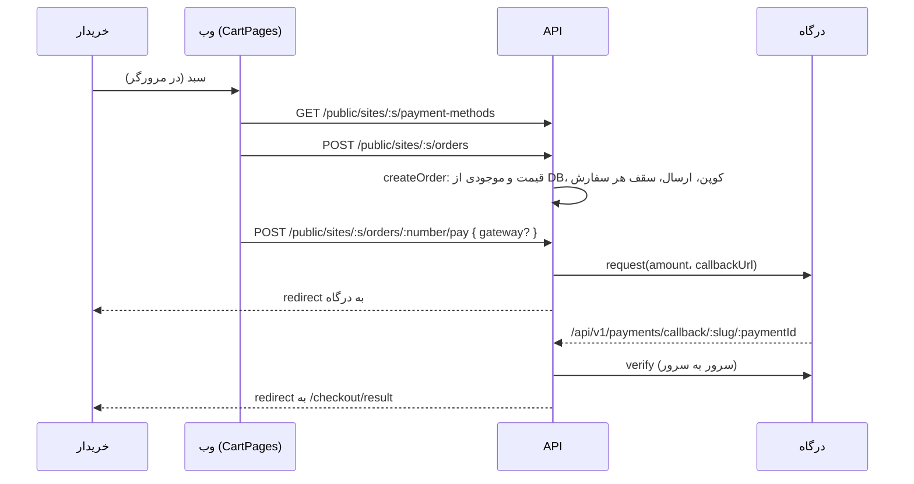
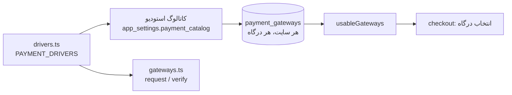

# فروشگاه و پرداخت

> فصل ۴ — قابلیت‌ها · API: `modules/catalog/catalog.ts`، `modules/orders/`، `modules/shop/`، `modules/payments/` ·
> وب: `features/cart/`، `features/public-site/pages/ProductsPages.tsx`، `admin/pages/CatalogPages.tsx`،
> `admin/pages/PaymentsPages.tsx` · خلاصهٔ انگلیسی: [`docs/features/shop.md`](../../features/shop.md)

## خلاصه
- محصولات و خدمات جدول‌های خودشان را دارند.
- سبد خرید در مرورگر نگه داشته می‌شود. ساختن سفارش، بررسی موجودی، تخفیف و هزینهٔ ارسال روی سرور
  انجام می‌شود.
- پرداخت از طریق **درگاه‌ها** انجام می‌شود. هر درگاه یک **driver** در کد دارد و برای هر سایت یک ردیف
  تنظیمات در `payment_gateways`.

## سفارش، از سبد تا پرداخت

- **قیمت از مرورگر قبول نمی‌شود.** `createOrder` قیمت، variant و موجودی را از دیتابیس می‌خواند.
- **فقط `verify` پرداخت را موفق می‌کند.** پاسخ درگاه روی آدرس بازگشت فقط «احتمالاً پرداخت شد» است.
- خریدار سفارش را با یک token عمومی می‌بیند (`orders.public_token_hash`، `findOrderForBuyer`).

## محصولات و خدمات
`products`: قیمت به واحد کوچک پول (`price_minor`)، درصد تخفیف، رنگ‌ها، variantها (سایز، مدل… با
قیمت و موجودی خودشان)، سقف هر سفارش، موجودی، ویژه، دسته (`settings.productCategories` با slug)،
جنس، ابعاد، زمان آماده‌سازی، عکس‌های بیشتر و ویژگی‌ها.
`services`: صفحهٔ فهرست و صفحهٔ هر خدمت (داخلی یا به‌صورت صفحهٔ builder).

محصولات می‌توانند منبع سکشن «List from a table» هم باشند (`source: 'products'`، `listProductsAsItems`).

## قوانین فروشگاه (`settings.shop`)
- فیلدهای پرداخت (`shop.checkout`، مثلاً آدرس اجباری)
- روش‌های ارسال (`shop.shipping`: هزینه، و «رایگان بالای …»)
- مراحل سفارش (`shop.orderStatuses`) با اعلان و پیام هر مرحله
- کد تخفیف (`coupons`: درصدی یا مبلغی، حداقل خرید، تعداد استفاده، تاریخ)
- پرداخت در محل (`payment_settings.allow_cod`)

نظرهای محصول (`product_reviews`) تا وقتی کارکنان تأییدشان نکنند نمایش داده نمی‌شوند. مشترکان
خبرنامه در `subscribers` هستند و علاقه‌مندی‌ها در `features/wishlist/`.

## درگاه‌های پرداخت

### driver
هر driver در `drivers.ts` این‌ها را دارد:
- `key` و `name`،
- `fields`: فیلدهای اطلاعات اتصال. فرم پنل از روی همین‌ها ساخته می‌شود و هر فیلد `pattern` اعتبارسنجی دارد.
- `testMode`:
  - `toggle`: کارکنان حالت تست را روشن می‌کنند،
  - `auto`: یک اطلاعات اتصال مخصوص تست آن را تستی می‌کند،
  - `always`: هیچ‌وقت پول جابه‌جا نمی‌شود.
- `available(ctx)`: مثلاً `sandbox` در production در دسترس نیست.
- `create(...)`: یک `PaymentGateway` از `gateways.ts` می‌سازد.
- `readCallback(answer)`: پارامترهای بازگشت را به `{ authority, status: 'OK' | 'NOK' }` تبدیل می‌کند.

driverهای فعلی: `zarinpal`، `zibal`، `idpay` و `sandbox` (صفحهٔ آزمایشی محلی).
کد درگاه‌ها از روی مستندات عمومی هر سرویس نوشته شده و فقط با HTTP شبیه‌سازی‌شده تست شده است.
→ [دستورالعمل: درگاه جدید](../05-recipes/new-payment-gateway.md)

### سه سطح تنظیم
| سطح | کجا | چه چیزی |
|---|---|---|
| استودیو | Platform ← Payment gateways (`catalog.ts`) | اینکه سایت‌ها اصلاً می‌توانند این درگاه را بگیرند، پیش‌فرض برای سایت‌های جدید، نام و توضیح پیش‌فرض |
| اپراتور برای هر سایت | `PUT …/payment-settings/gateways/:provider/access` | `allowed` |
| کارکنان سایت | `PUT …/payment-settings/gateways/:provider` | `enabled`، اطلاعات اتصال، حالت تست، نام و توضیح؛ و ترتیب (`PUT …/order`) |

ردیف‌های غایب با پیش‌فرض‌های کاتالوگ ساخته می‌شوند (`ensureGatewayRows`). درگاهی که ممنوع شود،
خاموش و از دید کارکنان سایت پنهان می‌شود. سرور مشتری کاتالوگ ندارد و فقط ردیف‌های سایت تعیین‌کننده‌اند.

### پرداخت و تراکنش‌ها
- `usableGateways`: درگاه‌هایی که مجاز، روشن، در دسترس روی این سرور و با اطلاعات اتصال معتبر هستند،
  به ترتیب سایت.
- `pay` یک `gateway` اختیاری می‌گیرد؛ اگر نباشد، اولین درگاه استفاده می‌شود. هر پرداخت `provider`
  خودش را نگه می‌دارد، پس حتی اگر درگاه بعداً خاموش شود، verify می‌شود.
- **تراکنش‌ها** (`GET /sites/:s/payments`، مجوز `payments:manage`): همهٔ تلاش‌ها با فیلتر.
- **«Check again»** (`POST …/payments/:id/recheck`) از درگاه می‌پرسد: اگر پرداخت شده باشد ثبت
  می‌شود؛ اگر نه و بیش از ۳۰ دقیقه گذشته باشد، شکست‌خورده می‌شود.
- **«Test connection»** (`POST …/gateways/:provider/test`) یک درخواست پرداخت کوچک می‌فرستد ولی
  خریدار هیچ‌وقت به درگاه نمی‌رود، پس پولی جابه‌جا نمی‌شود.
- درخواست‌ها (leads) هم با همین مسیر پرداخت می‌شوند (`startRequestPayment`).

## باز
صفحهٔ پیگیری سفارش و درخواست مشتری هنوز با اولین درگاه پرداخت می‌کند و انتخاب درگاه ندارد
(→ `docs/STATUS.md`).

## تست
`apps/api/test/shop.test.ts`، `apps/api/test/payments.test.ts`.
