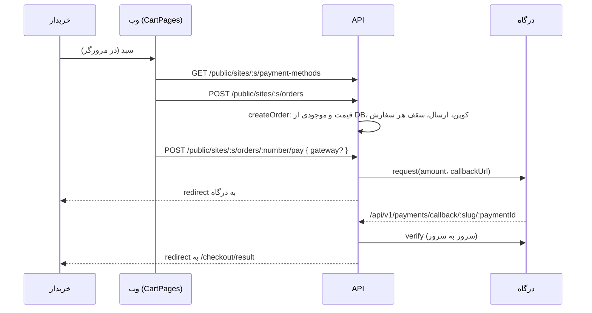
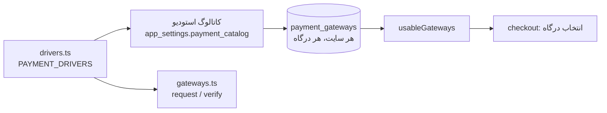

# فروشگاه و پرداخت

> فصل ۴ — قابلیت‌ها · API: `modules/catalog/catalog.ts`، `modules/orders/`، `modules/shop/`، `modules/payments/` ·
> وب: `features/cart/`، `features/public-site/pages/ProductsPages.tsx`، `admin/pages/CatalogPages.tsx`،
> `admin/pages/PaymentsPages.tsx` · خلاصهٔ انگلیسی: [`docs/features/shop.md`](../../features/shop.md)

## خلاصه
این صفحه رفتار عمومی محصول را توصیف می‌کند؛ دامنه، حساب و وضعیت استقرار هر مشتری در docs/clients ثبت می‌شود.
- محصولات و خدمات جدول‌های خودشان را دارند.
- سبد خرید در مرورگر نگه داشته می‌شود. ساختن سفارش، بررسی موجودی، تخفیف و هزینهٔ ارسال روی سرور
  انجام می‌شود.
- پرداخت از طریق **درگاه‌ها** انجام می‌شود. هر درگاه یک **driver** در کد دارد و برای هر سایت یک ردیف
  تنظیمات در `payment_gateways`.

## سفارش، از سبد تا پرداخت

- **قیمت از مرورگر قبول نمی‌شود.** `createOrder` قیمت، variant و موجودی را از دیتابیس می‌خواند.
- **فقط `verify` پرداخت را موفق می‌کند.** پاسخ درگاه روی آدرس بازگشت فقط «احتمالاً پرداخت شد» است.
- خریدار سفارش را با یک token عمومی می‌بیند (`orders.public_token_hash`، `findOrderForBuyer`).

## محصولات و خدمات
`products`: قیمت به واحد کوچک پول (`price_minor`)، درصد تخفیف، رنگ‌ها، variantها (سایز، مدل… با
قیمت و موجودی خودشان)، سقف هر سفارش، موجودی، ویژه، دسته (`settings.productCategories` با slug)،
جنس، ابعاد، زمان آماده‌سازی، عکس‌های بیشتر و ویژگی‌ها.
`services`: صفحهٔ فهرست و صفحهٔ هر خدمت (داخلی یا به‌صورت صفحهٔ builder).

محصولات می‌توانند منبع سکشن «List from a table» هم باشند (`source: 'products'`، `listProductsAsItems`).

## قوانین فروشگاه (`settings.shop`)
- فیلدهای پرداخت (`shop.checkout`، مثلاً آدرس اجباری)
- روش‌های ارسال (`shop.shipping`: هزینه، و «رایگان بالای …»)
- مراحل سفارش (`shop.orderStatuses`) با اعلان و پیام هر مرحله
- کد تخفیف (`coupons`: درصدی یا مبلغی، حداقل خرید، تعداد استفاده، تاریخ)
- پرداخت در محل (`payment_settings.allow_cod`)

نظرهای محصول (`product_reviews`) تا وقتی کارکنان تأییدشان نکنند نمایش داده نمی‌شوند. مشترکان
خبرنامه در `subscribers` هستند و علاقه‌مندی‌ها در `features/wishlist/`.

## درگاه‌های پرداخت

### driver
هر driver در `drivers.ts` این‌ها را دارد:
- `key` و `name`،
- `fields`: فیلدهای اطلاعات اتصال. فرم پنل از روی همین‌ها ساخته می‌شود و هر فیلد `pattern` اعتبارسنجی دارد.
- `testMode`:
  - `toggle`: کارکنان حالت تست را روشن می‌کنند،
  - `auto`: یک اطلاعات اتصال مخصوص تست آن را تستی می‌کند،
  - `always`: هیچ‌وقت پول جابه‌جا نمی‌شود.
- `available(ctx)`: مثلاً `sandbox` در production در دسترس نیست.
- `create(...)`: یک `PaymentGateway` از `gateways.ts` می‌سازد.
- `readCallback(answer)`: پارامترهای بازگشت را به `{ authority, status: 'OK' | 'NOK' }` تبدیل می‌کند.

driverهای فعلی: `zarinpal`، `zibal`، `idpay` و `sandbox` (صفحهٔ آزمایشی محلی).
کد درگاه‌ها از روی مستندات عمومی هر سرویس نوشته شده و فقط با HTTP شبیه‌سازی‌شده تست شده است.
→ [دستورالعمل: درگاه جدید](../05-recipes/new-payment-gateway.md)

### سه سطح تنظیم
| سطح | کجا | چه چیزی |
|---|---|---|
| استودیو | Platform ← Payment gateways (`catalog.ts`) | اینکه سایت‌ها اصلاً می‌توانند این درگاه را بگیرند، پیش‌فرض برای سایت‌های جدید، نام و توضیح پیش‌فرض |
| اپراتور برای هر سایت | `PUT …/payment-settings/gateways/:provider/access` | `allowed` |
| کارکنان سایت | `PUT …/payment-settings/gateways/:provider` | `enabled`، اطلاعات اتصال، حالت تست، نام و توضیح؛ و ترتیب (`PUT …/order`) |

ردیف‌های غایب با پیش‌فرض‌های کاتالوگ ساخته می‌شوند (`ensureGatewayRows`). درگاهی که ممنوع شود،
خاموش و از دید کارکنان سایت پنهان می‌شود. سرور مشتری کاتالوگ ندارد و فقط ردیف‌های سایت تعیین‌کننده‌اند.

### پرداخت و تراکنش‌ها
- `usableGateways`: درگاه‌هایی که مجاز، روشن، در دسترس روی این سرور و با اطلاعات اتصال معتبر هستند،
  به ترتیب سایت.
- `pay` یک `gateway` اختیاری می‌گیرد؛ اگر نباشد، اولین درگاه استفاده می‌شود. هر پرداخت `provider`
  خودش را نگه می‌دارد، پس حتی اگر درگاه بعداً خاموش شود، verify می‌شود.
- **تراکنش‌ها** (`GET /sites/:s/payments`، مجوز `payments:manage`): همهٔ تلاش‌ها با فیلتر.
- **«Check again»** (`POST …/payments/:id/recheck`) از درگاه می‌پرسد: اگر پرداخت شده باشد ثبت
  می‌شود؛ اگر نه و بیش از ۳۰ دقیقه گذشته باشد، شکست‌خورده می‌شود.
- **«Test connection»** (`POST …/gateways/:provider/test`) یک درخواست پرداخت کوچک می‌فرستد ولی
  خریدار هیچ‌وقت به درگاه نمی‌رود، پس پولی جابه‌جا نمی‌شود.
- درخواست‌ها (leads) هم با همین مسیر پرداخت می‌شوند (`startRequestPayment`).

## باز
صفحهٔ پیگیری سفارش و درخواست مشتری هنوز با اولین درگاه پرداخت می‌کند و انتخاب درگاه ندارد
(→ `docs/STATUS.md`).

## تست
`apps/api/test/shop.test.ts`، `apps/api/test/payments.test.ts`.

## ثبت سفارش با منوی ارسال موبایل

در تنظیمات فروشگاه، «روش ثبت سفارش» را روی «منوی ارسال موبایل» بگذارید و راهنمای گیرنده
و نمایش قیمت‌ها را تنظیم کنید. این مسیر از محصولات، سبد و فیلدهای تسویهٔ موجود استفاده می‌کند؛
سفارش در سرور ایجاد نمی‌کند. حالت پیش‌فرض ثبت سفارش و پرداخت آنلاین تغییری نکرده است.
محصول بدون قیمت فقط در حالت ارسال محلی به سبد اضافه می‌شود؛ برای چنین منویی نمایش قیمت
را خاموش کنید. متن سفارش، تعداد، گزینه‌ها و مشخصات مشتری را دارد و لغو ارسال سبد را پاک نمی‌کند.
راهنمای بدون کد: [ثبت سفارش محلی](../../guide/share-orders.md).

اسکیمای shopSchema در shared، پنل در CheckoutSettingsEditor، صفحه در ShareCheckoutPage.tsx
و منطق متن/ارسال در shareOrder.ts است. مرورگر Web Share را صدا می‌زند؛ نبود پشتیبانی مسیر
نمایش و کپی متن دارد. اپ اندروید کافه با intent و بررسی مبدأ معتبر منوی سیستم را باز می‌کند.
انتخاب برنامه/گیرنده و تأیید نهایی با مشتری است؛ رسید ارسال یا تأیید دریافت از این API نداریم.

در حالت ارسال محلی، مقصد chooser یا instagram است. مقصد اینستاگرام یک آیدی مستقل در
shop.instagramUsername دارد و متن را کپی و لینک ig.me را باز می‌کند؛ خودکار واردکردن متن
یا ارسال دایرکت ندارد. در Android نسخهٔ ۰٫۳٫۰، کپی native و intent به اینستاگرام انجام می‌شود.
برای مرورگر، در صورت رد مجوز clipboard صفحهٔ متن و لینک دستی باقی می‌ماند. اسکیمای آیدی
و مسیرهای موفق/لغو/خطا تست دارند؛ لینک گیرنده روی گوشی مالک تأیید شده است.

## سفارش حساب‌محور و حساب واسط اینستاگرام

در حالت `shop.orderMode=instagram`، مشتری وارد حساب می‌شود و آدرسی از پروفایل خود انتخاب می‌کند.
API هویت را از نشست و آدرس را از رکورد همان مشتری می‌خواند. تراکنش موجود سفارش، اقلام،
موجودی و پیام `instagram_outbox` را با هم ذخیره می‌کند؛ `requestId` برای هر مشتری جلوی تکرار
همان درخواست را می‌گیرد. سفارش بدون قیمت، `pricing_pending` دارد و قابل پرداخت نیست.

`accounts.signupVerification` به‌صورت پیش‌فرض فعال است. خاموش‌کردن آن، ثبت‌نام با رمز را
ممکن می‌کند، اما شماره تأییدشده محسوب نمی‌شود و سفارش‌های قدیمی با شمارهٔ مشابه به حساب
منتقل نمی‌شوند. حداکثر ده آدرس در پروفایل ذخیره می‌شود و مالک آن‌ها را در فهرست مشتریان می‌بیند.

کارت «حساب واسط اینستاگرام» در تنظیمات فروشگاه از API خصوصی زیر مسیر
`orders/instagram-connection` استفاده می‌کند. رمز، نشست و کد موقت با AES-GCM رمز می‌شوند.
این اطلاعات در تنظیمات عمومی نیستند. تغییر اطلاعات، نشست قبلی را حذف می‌کند.
worker جداگانهٔ `deploy/instagram-relay/worker.py` با نقش محدود دیتابیس، ورود و ارسال را انجام
می‌دهد. کد تأیید از پنل دریافت می‌شود؛ بعضی checkpointها هنوز به اپ رسمی نیاز دارند.

وضعیت ارسال در جزئیات سفارش دیده می‌شود. نتیجهٔ نامعلوم یا خطا خودکار تکرار نمی‌شود؛
فعلاً دکمهٔ ارسال مجدد وجود ندارد. قطع اینستاگرام سفارش ثبت‌شده را حذف نمی‌کند.
راهنمای کاربر: [ثبت سفارش اینستاگرامی](../../guide/instagram-orders.md).
جزئیات انگلیسی و تست‌ها: [instagram-orders.md](../../features/instagram-orders.md).
## جدول زندهٔ سفارش‌ها

صفحهٔ `InboxPages.tsx` کش TanStack Query را نگه می‌دارد و از `useOrderLive.ts` برای اتصال SSE
استفاده می‌کند. migration شمارهٔ 014 روی تغییرات سفارش، اقلام، پرداخت و ارسال، پس از commit
اعلان PostgreSQL می‌فرستد. `orders/live.ts` یک اتصال LISTEN برای هر دیتابیس فعال نگه می‌دارد
و فقط پیام تغییر بدون اطلاعات مشتری را به پنل‌های مجاز می‌دهد. پنل سپس دادهٔ فعلی را با API
معمول می‌گیرد. اتصال هر دقیقه با بررسی مجدد دسترسی وصل می‌شود؛ در تب پنهان بسته می‌شود.
برای جدول سفارش‌ها polling دوثانیه‌ای وجود ندارد؛ polling قدیمی شمارندهٔ منوی کناری جداست.

انتخاب‌گر مرحله از API قبلی و قواعد فعلی موجودی و اعلان استفاده می‌کند. ثبت دستی پرداخت فقط
برای سفارش آفلاین بدون تراکنش درگاه و با مجوز `payments:manage` مجاز است؛ مبلغ تغییر نمی‌کند
و انتقال وجه انجام نمی‌شود. تغییرات در تاریخچهٔ داخلی و audit ثبت می‌شوند. پرداخت آنلاین
همچنان باید از مسیر تأیید درگاه مدیریت شود.

`OrderQuickView.tsx` با hover، focus یا لمس، جزئیات را به‌صورت lazy و در portal نشان می‌دهد.
پارامتر `preview=true` در GET جزئیات سفارش جلوی mark-read را می‌گیرد؛ بازکردن جزئیات کامل،
همان رفتار قبلی را دارد. راهنمای کاربر: [جدول سفارش‌ها](../../guide/order-inbox.md).

## ثبت سریع سفارش حضوری

در صفحهٔ سفارش‌ها، `WalkInOrder.tsx` با Modal و دکمه‌های فعلی، دسته‌بندی‌های تنظیمات و محصولات
API را نمایش می‌دهد. `fetchAll` صفحه‌بندی کاتالوگ و `cartOps` تعداد و جمع را مدیریت می‌کنند؛
`finalPrice` همان گردکردن تخفیفِ فروشگاه را اعمال می‌کند. پیش‌نویس از سبد خرید مشتری مستقل است.
عکس‌های آپلودشده در مسیر عمومی فایل از همان origin پنل خوانده می‌شوند تا پنل لوکال به تونل وابسته نباشد.

مسیر خصوصی POST سفارش، `walkInOrderSchema` را می‌پذیرد و مجوز `orders:write` می‌خواهد.
همان سرویس `createOrder` با پارامتر داخلیِ ثبت‌کننده فراخوانی می‌شود؛ این پارامتر از بدنهٔ عمومی
پذیرفته نمی‌شود. بدون الزام حساب یا نشانی مشتری، همان تراکنشِ محصولات و اقلام، قیمت و موجودی را
بررسی می‌کند و وضعیت اولیه را `confirmed` می‌گذارد. `requestId` همراه قفل تراکنشی از ثبت تکراری
جلوگیری می‌کند. هیچ جدول یا migration جدیدی لازم نشد.

رسید با منبع `customer.source=walk_in` و شناسهٔ ثبت‌کننده ذخیره می‌شود، ابتدا پرداخت‌نشده است
و پیام اینستاگرام ایجاد نمی‌کند. تنظیم قیمت در کاتالوگ پیش‌نیاز افزودن محصول است؛ قیمت موقت یا
ساختگی وارد نمی‌شود. وضعیت و فاکتور و لغو، همان امکانات موجود سفارش‌اند.
راهنمای کاربر: [ثبت سریع حضوری](../../guide/walk-in-orders.md).

## تغییر چیدمان صندوق و پسوند پیامک

مودال صندوق اکنون از حالت تمام‌صفحهٔ اختیاری در Modal موجود استفاده می‌کند؛ این گزینه روی
مودال‌های دیگر اثر ندارد. ResizeObserver فضای منو را اندازه می‌گیرد و تعداد ستون/ردیف کارت‌ها
را از تعداد محصولات و فضای آزاد به‌دست می‌آورد. رسید یک ردیف با اسکرول افقی است و به ارتفاع
منو اضافه نمی‌شود. پس از ثبت موفق، مودال بسته و شمارهٔ سفارش با toast نشان داده می‌شود.
۲۴ کارت در پنجرهٔ ۵۴۲×۸۸۴ و با رسید پنج‌قلمی، بدون اسکرول عمودی منو بررسی شدند؛ برای تعداد
نامحدود آیتم روی صفحهٔ کوچک، خواناییِ عنوان/عکس محدودیت فیزیکی دارد.

در `auth/notifications.ts`، تابع `withSmsFooter` متن SMS عادی را با خط نهایی «لغو ۱۱»
خاتمه می‌دهد و نمونه‌های قبلیِ همان پسوند را تکرار نمی‌کند. کد OTP عدد خالص می‌ماند؛ متن
OTP واقعیِ کاوه‌نگار از قالب خارجی می‌آید و باید همان خط در قالب `verifycode` اضافه شود.
ابزار نگهداری به‌دلیل نبود اطلاعات کامل fallback در پاسخ سرویس، آن قالب را تغییر نداد.

### ردیف افقی محصولات
در تنظیمات صفحهٔ محصولات، چیدمان «عنوان دسته‌ها و ردیف افقی جمع‌وجور» را انتخاب کنید.
در سازنده هم هر بخش محصولات گزینهٔ «ردیف افقی جمع‌وجور» دارد. کارت و سبد خرید همان اجزای
موجود هستند؛ عنوان دسته‌ها از productCategories و محصولات از کاتالوگ خوانده می‌شوند.

### ظاهر سبد خرید
کامپوننت CartPage کارت‌های جمع‌وجور، کنترل تعداد + و − و خلاصه سفارش را نمایش می‌دهد.
محاسبه و محدودیت تعداد همان cartOps است؛ جمع هر ردیف با BigInt محاسبه می‌شود.
قیمت‌ها تابع shop.showPrices و مسیر ثبت سفارش همان checkout فعلی است. جایگاه‌های
قبل و بعد صفحه و استفاده به صورت محتوای داخلی در سازنده حفظ شده‌اند.
شمارندهٔ AddToCartButton مقدار lineKey متناظر را از CartProvider می‌خواند؛ عدد ثابت یا
state جدا برای تأیید افزودن ندارد. تست add-to-cart-count کلیک مکرر، سقف تعداد و پاک‌کردن را پوشش می‌دهد.

## نقشهٔ قابلیت‌های عمومی افزوده‌شده

| قابلیت | محل تنظیم / استفاده | منطق و محدودیت |
|---|---|---|
| ثبت‌نام بدون تأیید کد | تنظیمات حساب مشتری، signupVerification | پیش‌فرض روشن؛ خاموش‌کردن نیازمند رمز است و مالکیت شناسه را تأیید نمی‌کند؛ پروندهٔ قدیمی خودکار وصل نمی‌شود |
| آدرس‌های مشتری | حساب من ← مشخصات؛ فهرست مشتریان کارکنان | حداکثر ۱۰ آدرس نام‌دار در همان سایت؛ هویت و مالکیت آدرس هنگام ثبت سفارش کنترل می‌شود |
| ارسال سروری اینستاگرام | قوانین سفارش و کارت حساب واسط | سفارش ابتدا ذخیره می‌شود؛ worker هر نصب جداگانه آماده می‌شود؛ نمایش ارسال‌شده به معنای خوانده‌شدن نیست |
| سفارش‌های زنده | صفحهٔ سفارش‌ها | SSE احراز هویت‌شده، PostgreSQL NOTIFY و invalidation کش TanStack Query؛ بدون polling فهرست |
| تغییر مرحله در جدول | انتخاب‌گر هر ردیف | همان مجوز orders:write و قواعد انتقال مرحله؛ سفارش جدیدی ساخته نمی‌شود |
| ثبت وضعیت پرداخت دستی | انتخاب‌گر پرداخت | payments:manage؛ مخصوص ثبت دریافت/بازپرداخت آفلاین، بدون جابه‌جایی پول؛ تراکنش درگاه را تغییر نمی‌دهد |
| پیش‌نمایش سریع | ستون آخر سفارش، hover/focus/tap | همان جزئیات سفارش با preview=true، بدون علامت‌زدن خوانده‌شده |
| سفارش حضوری | دکمهٔ ثبت سفارش در فهرست | محصول قیمت‌دار، موجودی و سقف معتبر؛ مستقیم Confirmed و Unpaid؛ بدون نیاز به مشتری و بدون صف اینستاگرام |
| ظاهر موبایل و سبد | تنظیمات هدر، صفحهٔ محصولات و سازنده | [سند مستقل](../../features/mobile-storefront.md) و [راهنمای پنل](../../guide/mobile-storefront.md) |

مودال حضوری بعد از ثبت موفق بسته می‌شود. رسید تک‌ردیفی افقی است، کارت‌ها با فضای موجود کوچک
می‌شوند و + و − بزرگ‌اند؛ برای کاتالوگ‌های بزرگ، جستجو و دسته‌بندی همچنان لازم است.
این قابلیت‌ها به دامنه، کافه یا مت‌استک وابسته نیستند. سرویس SMS و worker باید برای هر نصب
به‌صورت مستقل تنظیم شوند. تنظیم پیش‌فرض محصول را با انتخاب یک مشتری اشتباه نگیرید.

### پیامک و OTP در محصول
پسوند پیامک متنی در adapter مرکزی به شکل یک خط جدید با «لغو ۱۱» اعمال می‌شود؛ پیام‌های
قالب‌دار OTP به قالب ذخیره‌شده نزد ارائه‌دهنده وابسته‌اند. نام قالب از تنظیمات همان ارائه‌دهنده
می‌آید و verifycode یک الزام عمومی محصول نیست. افزودن پسوند به token عددی مجاز نیست؛ قالب
باید جداگانه و با حفظ سیاست ارسال آن اصلاح شود. تست mocked، ارسال واقعی یا تحویل را ثابت نمی‌کند.

## کارت‌های ثبت سریع در موبایل
WalkInOrder در عرض کمتر از۶۰۰ پیکسل، عکس را در تمام کارت و متن سفید را روی نوار تیرهٔ
تقریباً مات قرار می‌دهد. کل کارت دکمهٔ افزودن است؛ کم‌کردن فقط در رسید افقی بالاست.
شبکه بر اساس فضای باقی‌مانده محاسبه می‌شود؛ حداقل ارتفاع مانع حذف کامل متن و عکس می‌شود
و اگر تعداد یا گزینه‌ها در صفحه جا نشوند، شبکه اسکرول می‌گیرد. دسکتاپ کنترل قبلی را دارد.
