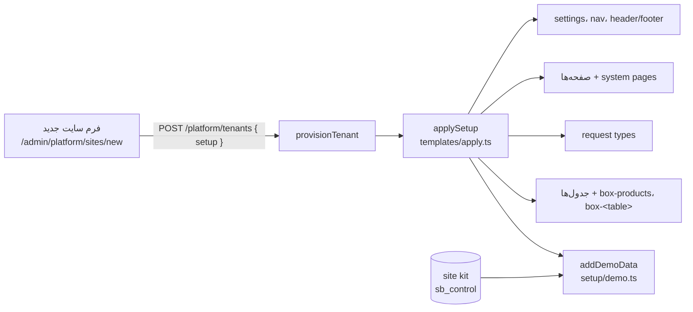

# ساخت سایت جدید، ماژول‌ها، kit و دادهٔ نمونه

> فصل ۴ — قابلیت‌ها · shared: `setup.ts`، `bank.ts` · API: `modules/platform/` (`platform.routes.ts`،
> `provisioning.ts`، `templates/`، `setup/`)، `modules/bank/` · وب: `admin/pages/SiteSetup.tsx`،
> `admin/pages/PlatformPages.tsx`، `admin/pages/BankPage.tsx` · خلاصهٔ انگلیسی: [`docs/features/site-setup.md`](../../features/site-setup.md)

## خلاصه
ساختن سایت دو لایه دارد:
1. **provisioning**: ساختن دیتابیس و role، migrationها، مالک و فعال‌سازی.
   → [چند-مستأجری](../02-architecture/multi-tenancy.md)
2. **setup** (اختیاری): تنظیمات، منو، صفحه‌ها، فرم‌ها، جدول‌ها، طرح باکس‌ها و دادهٔ نمونه، بر اساس
   فرمی که اپراتور پر کرده است.

## فرم سایت جدید
یک صفحه با بخش‌های تاشو، که با `siteSetupSchema` (shared `setup.ts`) اعتبارسنجی می‌شود:
- نوع کسب‌وکار، زبان‌ها و ظاهر، و تماس،
- صفحه‌ها و جای هر کدام در منو (اصلی، «More»، footer یا هیچ‌جا)،
- فرم‌ها از `SETUP_FORMS`، هر کدام با صفحه، workflow، دسترسی و اعلان‌های خودش،
- دکمه‌های header (تماس، WhatsApp، جست‌وجو)، footer، فروشگاه، فیلترها، جدول‌ها، حساب‌ها،
- تعداد دادهٔ نمونه.

۸ نوع کسب‌وکار در `templates/catalog.ts` تعریف شده‌اند و عکس‌هایشان در `templates/images.ts`.
**سایت پیش‌فرض** با تنظیمات خنثی ساخته می‌شود (`genericTemplate`). **سایت خالی** setup ندارد، صفحه‌ای
ندارد و همهٔ ماژول‌ها جز leads خاموش‌اند.

**عکس‌ها:** اول از `var/demo-images/<ref>.jpg`، اگر نبود از اینترنت، و اگر نشد یک placeholder
گرادیانی (`unsplash-<ref>.png`) استفاده می‌شود. فهرست سایت‌ها برای هر سایت `placeholderPhotos`
برمی‌گرداند و دکمهٔ «Refresh photos» (`POST /platform/tenants/:id/refresh-photos`) فقط وقتی دیده
می‌شود که این عدد بیشتر از صفر باشد.

## آدرس‌های platform
| آدرس (`/api/v1/platform/…`) | کار |
|---|---|
| `GET/POST tenants` | فهرست و ساخت سایت (`setup` اختیاری) |
| `GET/PATCH/DELETE tenants/:id` | یک سایت؛ حذف با `?confirm=<slug>` |
| `POST tenants/:id/retry` | ادامهٔ provisioning شکست‌خورده |
| `PUT tenants/:id/owner` | تغییر مالک |
| `GET/POST/DELETE tenants/:id/demo-data` | شمارش، افزودن و حذف دادهٔ نمونه |
| `POST tenants/:id/refresh-photos` | جایگزینی placeholderها |
| `GET templates` | نوع‌های کسب‌وکار |
| `GET/POST users`، `PATCH/DELETE users/:id`، `GET audit` | کاربران و رویدادها |

## ماژول‌ها
Settings ← Modules (فقط اپراتور، `MODULE_SWITCHES` در `SettingsPages.tsx`): `products`، `orders`،
`services`، `leads`. هر کلید فقط **همان بخش را باز می‌کند**: منوهای پنل، مسیرهای داخلی، API
(`requireModule`). صفحه، جدول یا دادهٔ نمونه اضافه نمی‌کند؛ این کار starterها و دادهٔ نمونه است.
`projects`، `testimonials` و `faq` هنوز در `MODULES` هستند ولی اثری ندارند و نمایش داده نمی‌شوند.

## دادهٔ نمونه
همهٔ ردیف‌های نمونه `demo = true` دارند: محصولات، خدمات، آیتم‌های جدول، مشتریان، درخواست‌ها، سفارش‌ها،
پرداخت‌ها و نظرها. ورودی پنجرهٔ «Sample data» با `demoRunSchema` تعریف می‌شود: نوع kit، افزودن یا
جایگزینی، و تعداد برای هر جدول.

`setup/demo.ts`:
- `addDemoData`، `clearDemoData`.
- `fieldValue`: مقدار ساختگی برای هر نوع فیلد.
- `itemTitle`: عنوان آیتم‌ها.
- فهرست کلمات در `setup/pools.ts`.

## site kits (بانک محتوا)
Platform ← Site kits (`BankPage.tsx`، `/platform/bank`). برای هر **نوع سایت** (general، ۸ نوع قالب و
نوع‌های خود استودیو در `bank_types`) مشخص می‌کند دادهٔ نمونه از چه ساخته شود:
- **جدول‌ها** (`kit_tables`): کپی یک starter جدول با آیتم‌ها و عکس‌های خودش، که در همان صفحه
  ویرایش می‌شود. ویرایش kit هیچ‌وقت به starter اصلی دست نمی‌زند (`addKitTable` عکس‌ها را کپی می‌کند).
- **لیست‌ها** (`bank_entries`، `BUILT_IN_KINDS`): محصولات، خدمات، نظرها، FAQ.
- **عکس‌ها** (`bank_photos`).

ساخت دادهٔ نمونه: هر جدول سایت آیتم‌های kit table با **همان slug** را می‌گیرد (اول kit همان نوع، بعد
general؛ `loadBank().table(slug)`). مقدارها هر جا با فیلد سایت جور باشند استفاده می‌شوند
(`kitValueFits`)، referenceها به آیتم‌های جدید منتقل می‌شوند و بقیه ساختگی ساخته می‌شوند.
`tenants.business_type` نوع هر سایت را نگه می‌دارد.

kit عمومی یک‌بار با جدول‌های starterهای آماده پر می‌شود (`seedGeneralKit`؛
`app_settings.general_kit_seeded`).

## تست
`apps/api/test/setup.test.ts`، `provisioning.test.ts`، `bank.test.ts`.

## تم‌ها و انتخاب بازدیدکننده
- تم‌های آماده (ivory، noir، sage) و تم‌های خود سایت (`design.themes`).
- `design.visitorThemes` (در `packages/shared/src/siteOptions.ts`) مشخص می‌کند دکمه‌های تم در header کدام تم‌ها را نشان دهند.
  خالی یعنی همه. اگر کمتر از دو تم بماند، دکمه‌ها نمایش داده نمی‌شوند (`ThemeSwitch` در
  `apps/web/src/components/layout/PreferenceControls.tsx`). در پنل: ظاهر سایت → «تم‌هایی که بازدیدکننده می‌تواند انتخاب کند».
