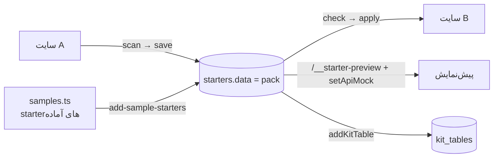

# starterها

> فصل ۴ — قابلیت‌ها · shared: `starters.ts` · API: `modules/starters/` (`pack.service.ts`، `samples.ts`،
> `starters.routes.ts`) · وب: `admin/pages/StartersPage.tsx`، `admin/starters.tsx`، `admin/StarterPreviewFrame.tsx` ·
> جدول: `starters` (sb_control) · خلاصهٔ انگلیسی: [`docs/features/starters.md`](../../features/starters.md)

## خلاصه
starter یک **نقطهٔ شروع خودکفا** است که روی هر سایتی (حتی سایت خالی) اعمال می‌شود. چهار نوع دارد:
صفحه، جدول، header و footer. داخلش یک **pack** است که هر چیزی را که آن صفحه یا جدول لازم دارد با
خودش می‌آورد.

## pack چه دارد
`starterPackSchema` (نسخهٔ ۲):

| بخش | چیست |
|---|---|
| `pages` | صفحه‌ها با نقش `main`، `detail` (صفحهٔ آیتم یک جدول) یا `linked` |
| `tables` | تعریف جدول‌ها |
| `forms` | request typeها |
| `cardDesigns` | طرح باکس‌های مشترک |
| `site.header` / `site.footer` | برای starterهای header و footer |
| `samples` | آیتم‌های هر جدول (reference با `ref`)، محصولات، دسته‌ها |
| `modules` | ماژول‌هایی که باید روشن شوند |
| `needs` | صفحه، جدول یا فرمی که استفاده می‌شود ولی داخل pack نیست |
| `photos` | کپی عکس‌ها در storage استودیو (پوشهٔ `BANK_STORAGE_ID`) |

آیتم‌ها و محصولات `id` عکس را نگه می‌دارند و متن‌ها آدرس آن را. starter حذف‌شده عکس‌هایش را هم پاک
می‌کند، مگر starter دیگری هنوز از آن‌ها استفاده کند. داده‌های قدیمی (`{document}`) هنگام خواندن با
`readStarterPack` تبدیل می‌شوند.

## ذخیره
| آدرس | کار |
|---|---|
| `POST /sites/:s/starters/scan` | از این انتخاب چه چیزی در starter قرار می‌گیرد: جدول‌های نمایش‌داده‌شده یا ارجاع‌شده و صفحه‌های آیتمشان خودکار؛ صفحه‌های لینک‌شده فقط اگر تیک بخورند؛ با `skip` حذف می‌شوند |
| `POST /sites/:s/starters` | ذخیره (`kind`، `name`، `group`، انتخاب، `samples`)؛ با `replace: <id>` محتوای starter موجود عوض می‌شود (راه به‌روزرسانی starter) |

starterهای header و footer از تنظیمات ذخیره‌شدهٔ سایت ساخته می‌شوند.

## اعمال
| آدرس | کار |
|---|---|
| `GET /sites/:s/starters/:id/check` | برای هر صفحه، جدول و فرم: داخل pack است یا فقط لازم است؛ در سایت وجود دارد، ندارد یا فرق دارد (فیلدهای غایب)؛ و پیشنهاد |
| `POST /sites/:s/starters/:id/apply` | برای هر مورد: `create` (با slug)، `use` (همانِ سایت) یا `skip` |

در اعمال:
- slugها **همه‌جا** عوض می‌شوند: لینک‌ها، منبع لیست‌ها، referenceها، صفحهٔ آیتم و فرم‌ها.
- فیلدهای غایب می‌توانند به جدول موجود اضافه شوند.
- ماژول‌ها روشن می‌شوند.
- همه در **یک تراکنش** انجام می‌شود.
- صفحهٔ اصلی draft می‌ماند و بقیه منتشر می‌شوند. نمونه‌ها `demo = true` دارند.

همهٔ routeهای `/sites/:s/starters` فقط برای اپراتور هستند. مدیریت در `/platform/starters` است:
فهرست بر اساس نوع و گروه، تغییر نام یا گروه (`PATCH`)، حذف.

## پیش‌نمایش
صفحه‌ها، headerها و footerها در iframe `/__starter-preview` (`StarterPreviewFrame.tsx`) و با ظاهر یک
سایت انتخابی نمایش داده می‌شوند. `setApiMock` (`lib/api.ts`) به درخواست‌های سایت ساختگی
`starter-preview` از روی خود pack جواب می‌دهد: تنظیمات، صفحه‌ها، جدول‌ها و آیتم‌ها، محصولات و یک مشتری
واردشده با درخواست و سفارش نمونه. درخواست‌های POST رد می‌شوند.

## starterهای آماده
`samples.ts` (`SAMPLES`، حدود ۵۰): 404، تماس، درباره، فروشگاه، صفحهٔ محصول، خدمات، دوره‌ها، کلاس‌ها،
رویدادها، بلاگ، فرم‌های درخواست، سبد و پرداخت، ورود و ثبت‌نام، چیدمان‌های حساب، پیگیری، ۶ جدول، ۴ header
و ۳ footer.

`node dist/cli.js add-sample-starters` در هر شروع API فقط آن‌هایی را اضافه می‌کند که `key`شان در
`app_settings.starter_samples` نیست. پس starter آماده‌ای که اپراتور حذف کرده **برنمی‌گردد**.
starterهای صفحه باید با slug گفته‌شده در توضیحشان اعمال شوند (مثل `not-found`، `products`، `account`)
تا جای صفحهٔ داخلی را بگیرند. → [دستورالعمل: starter آماده جدید](../05-recipes/new-ready-starter.md)

## تست
`apps/api/test/starters.test.ts`: همهٔ starterهای آماده را روی یک سایت خالی می‌سازد.
