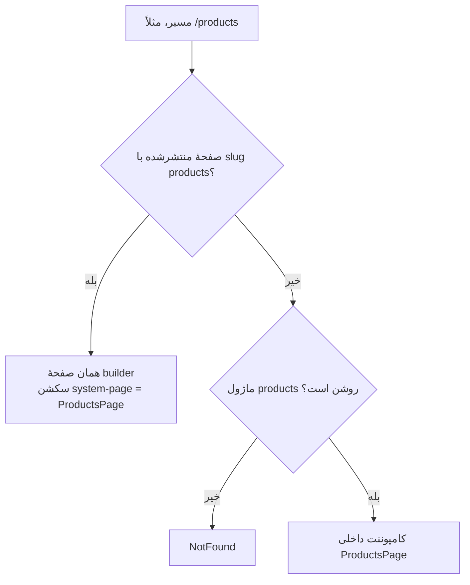

# صفحات داخلی (system pages)

> فصل ۴ — قابلیت‌ها · shared: `sections.ts` (`SYSTEM_PAGES`، `systemPageSections`) ·
> وب: `sections/BuiltInPage.tsx`، `app/routes.tsx`، `features/` · سند قدیمی‌تر: [`docs/features/site-setup.md`](../../features/site-setup.md)

## خلاصه
فروشگاه، صفحهٔ محصول، سبد، پرداخت، حساب مشتری، پیگیری و 404 **کامپوننت‌های داخلی** React هستند.
برای اینکه اپراتور بتواند دورشان سکشن‌های دلخواه بچیند، هر کدام یک **slug ثابت** دارد. اگر سایت یک صفحهٔ
منتشرشده با همان slug داشته باشد، آن صفحه نمایش داده می‌شود و کامپوننت داخلی درون سکشن
**`system-page`** («محتوای داخلی») قرار می‌گیرد.

## جدول صفحه‌ها
| key | slug | مسیر | ماژول لازم |
|---|---|---|---|
| `products` | `products` | `/products` | products |
| `productDetail` | `product` | `/products/…` | products |
| `services` | `services` | `/services` | services |
| `serviceDetail` | `service` | `/services/…` | services |
| `cart` | `cart` | `/cart` | products |
| `checkout` | `checkout` | `/checkout` | products |
| `checkoutResult` | `checkout-result` | `/checkout/result` | products |
| `account` | `account` | `/account` | — |
| `track` | `track` | `/track` | — |
| `notFound` | `not-found` | 404 | — |

## تصمیم‌گیری در `BuiltInPage`

- کامپوننت‌ها در `app/routes.tsx` با `registerSystemPages({...})` ثبت می‌شوند تا `sections/` و
  `features/` هم را import نکنند.
- داخل صفحهٔ builder، `EmbeddedContext` روشن است و کامپوننت داخلی فقط خودش را نشان می‌دهد (بدون
  دوباره پیچیدن در صفحه).
- در پیش‌نمایش builder، صفحهٔ محصول و خدمت اولین آیتم را نشان می‌دهند.

## گزینه‌های سکشن `system-page`
برای حساب مشتری: `accountMenu` (`tabs`، `sidebar`، `cards`، `none`)، `accountOpen` (`requests`،
`orders`، `profile`) و `authStart` (`login`، `signup`). کامپوننت‌ها با `useSystemPageOptions()`
می‌خوانندشان. به این ترتیب می‌شود صفحه‌های جدای «ورود»، «ثبت‌نام»، «سفارش‌های من» و «پروفایل» ساخت.

## ساختن این صفحه‌ها
- در پنل: Pages ← «Make it editable» (و «Make the 404 page editable»).
- setup سایت جدید آن‌ها را می‌سازد (فروشگاه به شکل یک صفحه با سکشن «List from a table» روی `/products`).
- starterهای آماده برای اغلبشان وجود دارد؛ باید با همان slug اعمال شوند.
- سکشن‌های پیش‌فرض هر کدام از `systemPageSections(key)` در shared می‌آیند.

## اگر بخواهید…
- صفحهٔ داخلی جدیدی اضافه کنید:
  1. یک ردیف به `SYSTEM_PAGES` اضافه کنید،
  2. سکشن‌های پیش‌فرضش را در `systemPageSections` بنویسید،
  3. کامپوننت را بسازید و در `registerSystemPages` ثبت کنید،
  4. مسیر را با `<BuiltInPage page="…">` در `app/routes.tsx` بگذارید.

  اگر به ماژولی وابسته است، `MODULE_OF` را در `BuiltInPage.tsx` هم به‌روز کنید.
