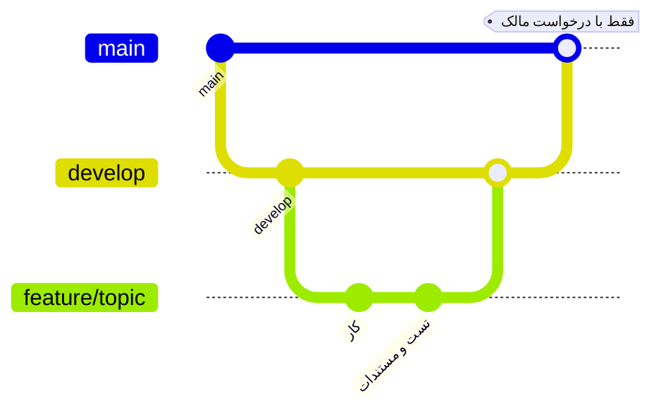

# Git

> فصل ۷ — قواعد · خلاصهٔ انگلیسی در `AGENTS.md` (بخش Git)

## شاخه‌ها

| شاخه | چیست |
|---|---|
| `develop` | شاخهٔ کار. هر کار از اینجا شروع می‌شود |
| `feature/<topic>` | هر کار یک شاخه (مثلاً `feature/payment-gateways`) |
| `main` | از `develop` عقب‌تر است؛ فقط وقتی مالک بخواهد به‌روز می‌شود |

## روند هر کار
شروع:
```bash
git switch develop
```
```bash
git pull
```
```bash
git switch -c feature/my-topic
```
پس از کار و تست:
```bash
git add <files>
```
```bash
git commit -m "Let each site offer several payment gateways"
```
```bash
git push -u origin feature/my-topic
```
merge به `develop` (فقط وقتی مالک بخواهد) و همیشه با `--no-ff`:
```bash
git switch develop
```
```bash
git merge --no-ff feature/my-topic
```
```bash
git push
```

## commit
- انگلیسی، امری و کوتاه، بدون پیشوند (`feat:` و امثالش نه): `Add the feature list and the empty-site start guide`.
- هر commit یک کار منطقی؛ تست و مستندات همان کار در همان شاخه.
- **هرگز force-push نکنید.**

## هرگز commit نکنید
`.env`، `deploy/.env`، `exports/`، `backups/`، `var/`، `var.rar`، و `*.tar.gz` و `*.jpg` در ریشه.
این‌ها دادهٔ مشتری و رمز دارند. بیشترشان در `.gitignore` هستند، ولی قبل از commit حتماً `git status`
را ببینید.

## remote
push از طریق حساب GitHub `bonshad2026` انجام می‌شود (در آدرس remote تنظیم شده است).
